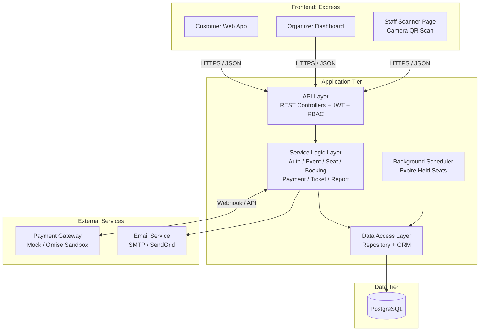
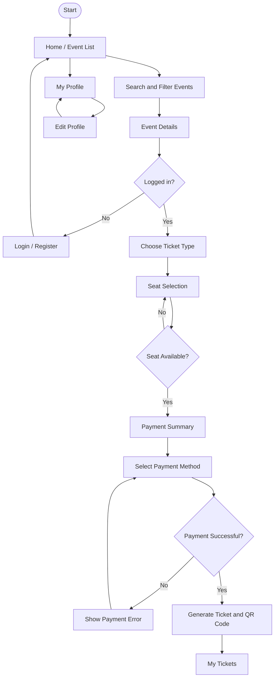
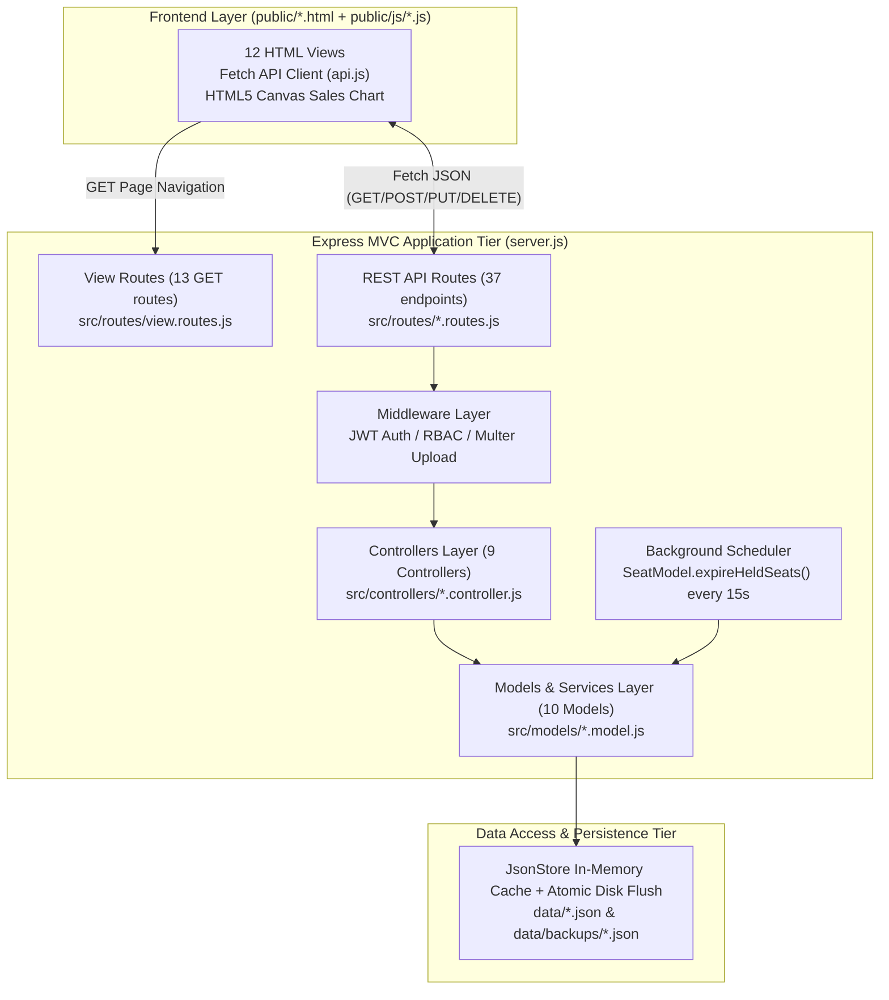

# Ticket Platform Web Application (TicketHub)

## สมาชิกกลุ่ม
| ลำดับ | ชื่อ-สกุล | รหัสนิสิต | บทบาทหน้าที่รับผิดชอบ (Role) |
| :---: | :--- | :---: | :--- |
| 1 | นางสาวชนิตา ชาญสำโรง | 68102010195 | UX/UI Designer & Frontend Developer |
| 2 | นายสิรวิชญ์ อัครสมบูรณ์ | 68102010217 | Backend Architect & DevOps Engineer |
| 3 | นายศุภกิตต์ แพรเมือง | 68102010561 | QA, Security & Data Engineer |

---
# ที่มาและความสำคัญ

ในสมัยนี้การจัดกิจกรรมไม่ว่าจะเป็นคอนเสิร์ต การแสดงสด หรืองานสัมมนา ได้รับความนิยมอย่างมาก ซึ่งเข้าถึงผู้คนทุกเพศทุกวัยและพฤติกรรมผู้บริโภคก็เปลี่ยนจากการซื้อตั๋วที่หน้างานมาเป็นการซื้อผ่านระบบออนไลน์ อย่างไรก็ตามก็มีหลากหลายผู้ให้บริการการซื้อจองตั๋วแต่อาจจะยังคงมีปัญหากับการจัดการกับปริมาณผู้ใช้ในช่วงที่ต้องมีการแย่งเพื่อจองตั๋ว รวมถึงปัญหาการนำตั๋วไปขายต่ออย่างปลอมแปลงและทุจริต

กลุ่มผู้จัดทำมองเห็นถึงแนวทางการจัดทำและพัฒนาระบบการจองตั๋วผ่านเว็ปแอปพลิเคชั่น (Ticket Platform Web Application) ซึ่งจะช่วยเป็นศูนย์กลางในการให้ผู้ใช้ค้นหาและติดตามกิจกรรม ดูรายละเอียดงาน เลือกโซนและที่นั่งจากผังที่นั่ง ชำระเงิน และรับบัตรอิเล็กทรอนิกส์ที่มี QR Code สำหรับใช้เข้างานได้ ระบบยังช่วยให้ผู้จัดงานหรือผู้ดูแลระบบสามารถจัดการข้อมูลกิจกรรม ผังที่นั่ง ประเภทและราคาบัตร ช่วงเวลาการขาย รายการจอง และข้อมูลการชำระเงินได้อย่างเป็นระบบ

โดยจะช่วยลดความซับซ้อนของกระบวนการซื้อบัตร เพิ่มความถูกต้องของข้อมูล และป้องกันการจองที่นั่งซ้ำ โดยกำหนดสิทธิ์ของที่นั่งตามผู้ที่ชำระเงินสำเร็จก่อน พร้อมทั้งมีการล็อกที่นั่งชั่วคราวระหว่างรอชำระเงิน นอกจากนี้ ระบบยังส่งเสริมประสบการณ์ของผู้ใช้ด้วยการแจ้งเตือนการชำระเงิน การเปลี่ยนแปลงกิจกรรม และการเปิดขายบัตรของกิจกรรมที่บันทึกไว้ รวมถึงรองรับการใช้งานผ่านอุปกรณ์หลายขนาด จึงช่วยให้ทั้งผู้ซื้อบัตรและผู้จัดงานสามารถดำเนินการได้อย่างมีประสิทธิภาพ ปลอดภัย และน่าเชื่อถือมากขึ้น

---
# จุดประสงค์ของโปรเจกต์

1. เพื่อพัฒนาระบบการจองตั๋วผ่านเว็บแอปพลิเคชันที่มีประสิทธิภาพสูง รองรับการเข้าใช้งานของผู้ใช้ในหลายแพลตฟอร์มพร้อมกันได้อย่างมีประสิทธิภาพในช่วงเวลาที่มีการเปิดจอง<br>
2. เพื่อเพิ่มความปลอดภัยและลดปัญหาการทุจริต เช่น การปลอมแปลงตั๋วและการนำตั๋วไปขายต่อเกินราคา ด้วยระบบตรวจสอบและยืนยันสิทธิ์ที่มีความน่าเชื่อถือ<br>
3. เพื่ออำนวยความสะดวกให้แก่ผู้จัดงานในการบริหารจัดการกิจกรรม ตั๋วเข้างาน และการวิเคราะห์ข้อมูลผู้เข้าร่วมงานได้อย่างเป็นระบบและเหมาะสมกับรูปแบบงาน<br>
   
---
# ประโยชน์ที่คาดว่าจะได้รับ 

1. สำหรับผู้ใช้งาน : ได้รับความสะดวกในการจองตั๋วผ่านระบบออนไลน์ที่เสถียร ไม่หลุดหรือค้างระหว่างทำรายการ และมั่นใจได้ว่าจะได้รับตั๋วแท้ที่ปลอดภัยจากการทุจริต<br>
2. สำหรับผู้จัดงาน : มีระบบการจัดการตั๋วที่ยืดหยุ่น ปรับแต่งให้เหมาะสมกับรูปแบบงานได้ง่าย พร้อมระบบสรุปข้อมูลการขายแบบ Real-time ช่วยลดภาระงานและเพิ่มความเรียบร้อยในการตรวจตั๋วหน้างาน<br>
3. สำหรับภาพรวมระบบ : ช่วยสร้างมาตรฐานใหม่ให้กับระบบ Ticketing Platform ที่ลดปัญหาบัตรผี และรองรับภาระการจราจรของข้อมูลมหาศาลได้อย่างมีประสิทธิภาพ<br>

---
# ขอบเขตของโปรเจกต์
ในโครงการนี้จะครอบคลุมถึงการพัฒนาระบบจองบัตรคอนเสิร์ตและกิจกรรมผ่านช่องทางออนไลน์สำหรับผู้ใช้งานทั่วไปและผู้ดูแลระบบ โดยมีดังนี้
1. ระบบผู้ใช้งาน \
   ผู้ใช้สามารถลงทะเบียนสมัครสมาชิกได้ด้วยวิธี Gmail, Facebook หรือหมายเลขโทรศัพท์ ออกจากระบบ และแก้ไขข้อมูลส่วนบุคคล
2. การค้นหากิจกรรม \
   ผู้ใช้สามารถดูรายการกิจกรรมตามหมวดหมู่ ค้นหาจากชื่องานหรือศิลปิน กรองตามประเภท วันที่ ศิลปิน และช่วงเวลาขายบัตร รวมถึงดูกิจกรรมยอดนิยมและบันทึกกิจกรรมที่สนใจ
3. รายละเอียดกิจกรรม \
   แสดงข้อมูลสำคัญของกิจกรรม โปสเตอร์ ชื่องาน ศิลปิน รายละเอียด วันและเวลา สถานที่ ราคา สถานะการขาย และผังที่นั่ง ผู้ใช้สามารถเลือกวันที่ รอบการแสดง และโซนที่ต้องการได้
4. การจองบัตรและเลือกที่นั่ง
   ระบบแสดงผังและหมายเลขที่นั่ง พร้อมสถานะว่าง จองแล้ว และกำลังเลือก ผู้ใช้สามารถเลือกหรือยกเลิกที่นั่งก่อนชำระเงินได้ ระบบแบ่งโซนที่นั่ง กำหนดราคาในแต่ละโซน แสดงจำนวนที่นั่งคงเหลือ และป้องกันการจองที่นั่งซ้ำ
5. การชำระเงินและการออกบัตร
   ระบบแสดงสรุปรายการจองและยอดชำระเงินก่อนยืนยัน รองรับการชำระเงินผ่าน QR Code หรือ PromptPay บัตรเครดิต บัตรเดบิต KBank Krung Thai และ TrueMoney เมื่อชำระเงินสำเร็จ ระบบจะบันทึกรายการจอง ออกบัตรพร้อม QR Code และเปลี่ยนสถานะที่นั่งเป็นจองแล้ว
การชำระเงินและการออกบัตร
6. บัตรและประวัติการใช้งาน
   ผู้ใช้สามารถดูบัตรอิเล็กทรอนิกส์ ประวัติการซื้อ และสถานะการจองได้ โดย QR Code ใช้สำหรับตรวจสอบสิทธิ์เข้างาน และเมื่อมีการเช็กอินแล้ว ระบบต้องป้องกันการนำบัตรเดิมมาใช้ซ้ำ
7. การแจ้งเตือน การยกเลิก และการคืนเงิน
   ระบบแจ้งเตือนผลการชำระเงิน การเปลี่ยนแปลงรายละเอียดกิจกรรม และสถานะกิจกรรมที่ผู้ใช้บันทึกไว้ ผ่านการแจ้งเตือนภายในเว็บไซต์และอีเมล ผู้ใช้สามารถยกเลิกบัตรตามเงื่อนไขของกิจกรรม และระบบคำนวณยอดคืนเงินตามนโยบายโดยไม่คืนค่าธรรมเนียมบริการ
8. ระบบผู้ดูแล
   ผู้ดูแลระบบสามารถตรวจสอบสิทธิ์ จัดการกิจกรรม ผังที่นั่ง โซน ราคา จำนวนบัตร ช่วงเวลาการขาย รายการจอง และข้อมูลการชำระเงินได้ รวมถึงดูรายงานหรือกราฟยอดขายบัตรรายเดือน
9. ด้านคุณภาพระบบ
   ระบบรองรับการใช้งานบนคอมพิวเตอร์ แท็บเล็ต และโทรศัพท์มือถือ โดยออกแบบให้ใช้งานง่าย มีการตอบสนองรวดเร็ว พร้อมให้บริการต่อเนื่อง และรองรับผู้ใช้จำนวนมากในช่วงเปิดขายบัตร ระบบต้องรักษาความปลอดภัยของบัญชีและข้อมูลส่วนบุคคลด้วยการยืนยันตัวตน การกำหนดสิทธิ์ การเข้ารหัสรหัสผ่าน และ HTTPS รวมถึงมีการสำรองและกู้คืนข้อมูลสำคัญ
   
---
# Functional and Non-Functional Functional
## Functional Requirements

| ID | Module | Requirement | Description |
|---|---|---|---|
| FR-01 | Authentication | Login | ผู้ใช้สามารถเข้าสู่ระบบด้วย Gmail, Facebook หรือเบอร์โทรศัพท์ |
| FR-02 | Authentication | Register | ผู้ใช้สามารถสมัครสมาชิกโดยกรอกชื่อ, Email, อายุ, เบอร์โทรศัพท์, Password, วันเกิด, เพศ, เลขบัตรประชาชน และที่อยู่ |
| FR-03 | Authentication | Logout | ผู้ใช้สามารถออกจากระบบได้ |
| FR-04 | Profile | View Profile | ผู้ใช้สามารถดูข้อมูล Profile ของตนเองได้ |
| FR-05 | Profile | Edit Profile | ผู้ใช้สามารถแก้ไขข้อมูลส่วนตัวและเปลี่ยนรูป Profile ได้ |
| FR-06 | Event | Event Categories | ระบบสามารถแบ่ง Event เป็นหมวดหมู่ เช่น Concert และ Seminar |
| FR-07 | Event | Event Status | ระบบแสดงสถานะของ Event เช่น Coming Soon, On Sale, Sold Out และ Closed |
| FR-08 | Event | Search Event | ผู้ใช้สามารถค้นหา Event จากชื่องาน, ชื่อศิลปิน หรือชื่อ Event |
| FR-09 | Event | Filter Event | ผู้ใช้สามารถกรอง Event ตามประเภท, วันที่, ศิลปิน และช่วงเวลาการเปิดขาย |
| FR-10 | Event | Popular Event | ระบบสามารถแสดง Event ที่ได้รับความนิยมเป็น Featured / Popular Event |
| FR-11 | Event | Bookmark | ผู้ใช้สามารถ Bookmark Event ที่สนใจได้ |
| FR-12 | Event | Event Details | ระบบแสดง Poster, ชื่องาน, ศิลปิน, รายละเอียด, วันที่, เวลา, เวลาเปิดประตู, สถานที่, ราคา และผังที่นั่ง |
| FR-13 | Event | Create Event | Admin สามารถเพิ่ม Event ใหม่ได้ |
| FR-14 | Event | Edit Event | Admin สามารถแก้ไขข้อมูล Event ได้ |
| FR-15 | Event | Delete Event | Admin สามารถลบ Event ได้ตามสิทธิ์ |
| FR-16 | Booking | Select Date / Round | ผู้ใช้สามารถเลือกวันที่, รอบ และเวลาของ Event ได้ |
| FR-17 | Booking | Seating Plan | ระบบต้องแสดงผังที่นั่งและหมายเลขที่นั่ง |
| FR-18 | Booking | Seat Status | ระบบแสดงสถานะที่นั่งเป็น Available, Selected และ Booked |
| FR-19 | Booking | Select Seat | ผู้ใช้สามารถเลือกและยกเลิกที่นั่งที่ต้องการได้ |
| FR-20 | Booking | Seat Availability | ระบบแสดงจำนวนที่นั่งว่างในแต่ละ Zone |
| FR-21 | Booking | Seat Zone | ระบบสามารถแบ่งที่นั่งเป็น Zone ต่าง ๆ ได้ |
| FR-22 | Booking | Seat Price | ระบบกำหนดและแสดงราคาตาม Zone ที่นั่ง |
| FR-23 | Booking | Prevent Double Booking | ระบบต้องป้องกันไม่ให้ผู้ใช้หลายคนจองที่นั่งเดียวกัน |
| FR-24 | Payment | Booking Summary | ระบบแสดงข้อมูลผู้ใช้, Event, Seat, ราคา, ค่าธรรมเนียม และยอดรวมก่อนชำระเงิน |
| FR-25 | Payment | Payment Methods | รองรับ QR Code / PromptPay, Credit Card, Debit Card, KBank, Krung Thai และ TrueMoney |
| FR-26 | Payment | Payment Confirmation | ระบบต้องแสดงยอดเงินและให้ผู้ใช้ยืนยันการชำระเงิน |
| FR-27 | Payment | Payment Success | เมื่อชำระเงินสำเร็จ ระบบบันทึก Booking และสร้าง Ticket |
| FR-28 | Ticket | My Tickets | ผู้ใช้สามารถดู Ticket ที่ซื้อไว้ได้ |
| FR-29 | Ticket | QR Ticket | Ticket ต้องมี QR Code สำหรับใช้ตรวจสอบการเข้างาน |
| FR-30 | Ticket | Ticket Validation | ระบบสามารถตรวจสอบ QR Code และเปลี่ยนสถานะเป็น Checked-in |
| FR-31 | Ticket | Prevent Reuse | Ticket ที่ Check-in แล้วไม่สามารถนำมาใช้ซ้ำได้ |
| FR-32 | History | Purchase History | ผู้ใช้สามารถดูประวัติการซื้อและสถานะ Booking ได้ |
| FR-33 | Notification | Payment Notification | ระบบแจ้งเตือนเมื่อชำระเงินสำเร็จ |
| FR-34 | Notification | Event Change | ระบบแจ้งเตือนเมื่อมีการเปลี่ยนแปลงวัน, เวลา, สถานที่ หรือรายละเอียด Event |
| FR-35 | Notification | Email Notification | ระบบสามารถส่ง Notification ผ่าน Email ได้ |
| FR-36 | Notification | Web Notification | ระบบแสดง Notification / Popup ภายในเว็บไซต์ |
| FR-37 | Notification | Bookmark Notification | ระบบแจ้งเตือนเมื่อ Event ที่ Bookmark เปิดขายหรือมีการเปลี่ยนแปลง |
| FR-38 | Cancellation | Cancel Ticket | ผู้ใช้สามารถยกเลิก Ticket ได้ตามเงื่อนไขของ Event |
| FR-39 | Cancellation | Refund | ระบบสามารถคำนวณและดำเนินการคืนเงินตามนโยบาย โดยไม่คืนค่าธรรมเนียม |
| FR-40 | Admin | Ticket Management | Admin สามารถกำหนดประเภทบัตร, จำนวนบัตร และราคาบัตร |
| FR-41 | Admin | Seating Management | Admin สามารถกำหนด Layout, Zone, สี, จำนวน และหมายเลขที่นั่ง |
| FR-42 | Admin | Booking Management | Admin สามารถตรวจสอบจำนวนบัตรที่จองและที่นั่งว่าง |
| FR-43 | Admin | Payment Management | Admin สามารถตรวจสอบสถานะการชำระเงิน |
| FR-44 | Admin | Sales Dashboard | ระบบแสดงกราฟยอดขายตั๋วรายเดือน |
| FR-45 | Support | Contact Admin | ผู้ใช้สามารถติดต่อ Admin เพื่อสอบถามหรือร้องเรียนได้ |
| FR-46 | Promotion | Point System | ผู้ใช้สามารถสะสมคะแนนจากการซื้อและใช้คะแนนตามเงื่อนไข |
| FR-47 | Promotion | Promotion | ระบบรองรับ Promotion และส่วนลด |
| FR-48 | Ticket Sale | Sale Period | Admin สามารถกำหนดวันเริ่มและสิ้นสุดการขายบัตร |
| FR-49 | Ticket Sale | Sale Restriction | ระบบไม่อนุญาตให้จองบัตรนอกช่วงเวลาที่กำหนด |
| FR-50 | Booking | Ticket Holder Name | ผู้ใช้งานสามารถใส่ชื่อ-สกุลลงในบัตรของแต่ละใบได้ |

## Email Notification Configuration (FR-35)

Notifications with the `EMAIL` or `BOTH` channel are sent asynchronously over SMTP. Configure these environment variables to enable delivery:

```env
SMTP_HOST=smtp.example.com
SMTP_PORT=587
SMTP_SECURE=false
SMTP_USER=your-smtp-username
SMTP_PASS=your-smtp-password
EMAIL_FROM=TicketHub <tickets@example.com>
```

`SMTP_USER` and `SMTP_PASS` may be omitted for an unauthenticated relay. Keep real credentials in the deployment environment and never commit them. Notification records expose `emailStatus` (`PENDING`, `SENT`, `FAILED`, or `NOT_CONFIGURED`) so delivery failures are visible.

## Non-Functional Requirements

| ID | Category | Requirement | Description |
|---|---|---|---|
| NFR-01 | Performance | Fast Response | ระบบต้องตอบสนองต่อการใช้งานและโหลดหน้าเว็บได้อย่างรวดเร็ว |
| NFR-02 | Performance | Fast Loading | หน้า Event, Seat และ Payment ไม่ควรใช้เวลาโหลดนานจนกระทบการใช้งาน |
| NFR-03 | Availability | System Availability | ระบบต้องพร้อมให้บริการอย่างต่อเนื่อง โดยเฉพาะช่วงเปิดขายบัตร |
| NFR-04 | Security | User Security | ระบบต้องรักษาความปลอดภัยของบัญชีและข้อมูลส่วนบุคคลของผู้ใช้ |
| NFR-05 | Security | Payment Security | ระบบต้องรักษาความปลอดภัยของข้อมูลและกระบวนการชำระเงิน |
| NFR-06 | Security | Authentication | ระบบต้องมีการตรวจสอบตัวตนของผู้ใช้และ Admin |
| NFR-07 | Security | Authorization | ระบบต้องจำกัดสิทธิ์การเข้าถึงข้อมูลและฟังก์ชันของ Admin |
| NFR-08 | Data Integrity | Booking Integrity | ระบบต้องป้องกัน Double Booking และรักษาความถูกต้องของข้อมูลที่นั่ง |
| NFR-09 | Data Integrity | Transaction Integrity | ข้อมูล Booking, Payment และ Ticket ต้องสอดคล้องกัน |
| NFR-10 | Reliability | System Reliability | ระบบต้องสามารถทำงานได้อย่างถูกต้องและจัดการข้อผิดพลาดได้ |
| NFR-11 | Backup & Recovery | Data Backup | ระบบต้องสำรองข้อมูล User, Event, Seat, Booking, Payment และ Ticket |
| NFR-12 | Backup & Recovery | Data Recovery | ระบบต้องสามารถกู้คืนข้อมูล Ticket และ Booking เมื่อระบบเกิดความเสียหาย |
| NFR-13 | Scalability | Concurrent Users | ระบบควรรองรับผู้ใช้งานจำนวนมากพร้อมกัน โดยเฉพาะช่วงเปิดขาย |
| NFR-14 | Usability | Ease of Use | ระบบต้องใช้งานง่ายและมีขั้นตอนการจองที่ไม่ซับซ้อน |
| NFR-15 | Usability | Clear Information | ข้อมูลสำคัญ เช่น ราคา, ที่นั่ง และยอดชำระต้องแสดงอย่างชัดเจน |
| NFR-16 | Compatibility | Responsive | ระบบต้องรองรับ Desktop, Tablet และ Mobile |
| NFR-17 | Maintainability | Maintainable System | ระบบควรออกแบบให้สามารถแก้ไขและเพิ่ม Feature ได้ง่าย |

## Theme & UI/UX

| ID | Category | Requirement | Description |
|---|---|---|---|
| UI-01 | Theme | Oat Milk | ใช้สีหลัก Oat Milk `#FDF9F2` |
| UI-02 | Theme | Monday Blue | ใช้สีหลัก Monday Blue `#1D56CF` |
| UI-03 | Theme | Candy Apple | ใช้สี Accent Candy Apple `#FF0800` |
| UI-04 | Seat | Available Seat | ที่นั่งว่างแสดงเป็นวงกลมสีดำ ขอบสีขาว พร้อมหมายเลขที่นั่ง |
| UI-05 | Seat | Booked Seat | ที่นั่งที่ถูกจองแสดงด้วยเครื่องหมาย `✕` |
| UI-06 | Seat | Selected Seat | ที่นั่งที่ผู้ใช้เลือกแสดงด้วยเครื่องหมาย `✓` |
| UI-07 | Seat | Zone | แต่ละ Zone สามารถกำหนดสีและราคาแตกต่างกันได้ |
| UI-08 | Responsive | Mobile | รองรับการใช้งานบนโทรศัพท์มือถือ |
| UI-09 | Responsive | Desktop | รองรับการใช้งานบนคอมพิวเตอร์ |
| UI-10 | UX | Easy to Use | Interface ต้องเข้าใจง่ายและใช้งานสะดวก |
| UI-11 | UX | Booking Flow | ขั้นตอนการจองควรชัดเจน ตั้งแต่เลือก Event → เลือกที่นั่ง → Review → Payment → Ticket |
| UI-12 | UX | My Tickets | หน้า My Tickets ใช้ Theme สี Oat Milk |
| UI-13 | UX | Booking | หน้าจองที่นั่งใช้ Monday Blue เป็นสีหลัก |

---
## Process, Methods, and Tools (กระบวนการทำงานและเครื่องมือ)

### 1. Process (กระบวนการทำงาน)
* **Agile Scrum Methodology:** ดำเนินการพัฒนาโดยแบ่งการทำงานออกเป็นรอบสั้น ๆ (Sprints) เพื่อให้ทีมสามารถตรวจสอบความคืบหน้า ปรับเปลี่ยนแผนงาน และส่งมอบงานได้อย่างยืดหยุ่น โดยใน **Sprint 1** เน้นกระบวนการเริ่มต้น ได้แก่ การเก็บรวบรวมความต้องการ (Requirement Collection) การวิเคราะห์ระบบ และการจัดทำรายงานโครงการ (Report)

### 2. Methods (วิธีการดำเนินงาน)
* **Requirement Engineering:** ทำการสัมภาษณ์ผู้ใช้งานจริง (คนนอกกลุ่ม) เพื่อเก็บรวบรวมความต้องการทั้งแบบ Functional และ Non-Functional นำมาวิเคราะห์ ออกแบบ และจัดทำเป็นเอกสารข้อกำหนดโครงการ (TOR)
* **Backlog Grooming & Sprint Planning:** แปลงความต้องการทั้งหมดให้อยู่ในรูปของ User Stories กำหนดรายละเอียดงาน (Work Items) จัดลำดับความสำคัญ และวางแผนงานลงใน Sprint Backlog เพื่อเตรียมพร้อมสำหรับการพัฒนาในเฟสถัดไป

### 3. Tools (เครื่องมือที่ใช้)
* **GitHub (Issues & Milestones):** ใช้สำหรับบริหารจัดการ Product Backlog, ติดตามสถานะงาน (Task Tracking) และวางแผน Sprint Backlog
* **GitHub Repository & Markdown:** ใช้สำหรับจัดเก็บเอกสารรายงานโครงการทั้งหมดในรูปแบบไฟล์ `README.md`
* **YouTube:** ใช้สำหรับอัปโหลดและเผยแพร่วิดีโอบันทึกการสัมภาษณ์เก็บ Requirement รวมถึงวิดีโอบันทึกการประชุมสรุปผลงาน (Retrospective) เพื่อใช้แปะลิงก์อ้างอิงในรายงาน
* **Figma** สำหรับออกแบบหน้าจอและสร้างต้นแบบระบบ
* **Visual Studio Code** สำหรับเขียนและจัดการโค้ด
---
# Requirements Youtube Link:
https://youtu.be/-l-ONZ0Nss0

# Retrospective Phase 1 Youtube Link:
https://youtu.be/y5xg2nNoAHg?si=fjigoSF_WZ-VYavK

# Retrospective Phase 2 Youtube Link:
https://youtu.be/W9PHzGiH1ts

---

# Product Backlog


# Sprint Backlog


# Example detail issue


# Design Prototype


# Document Diagram
## Architecture Design Diagram

## Use Case Diagram 


---

# Phase 3 Report — การพัฒนา การทดสอบโครงสร้างข้อมูล และการวัดประสิทธิภาพ (Implementation, Unit Testing, Coverage & Profiling)

## 1. อธิบายการทำงานของโปรแกรม (Program Architecture & Mechanics)

ระบบ **TicketHub** พัฒนาบนรันไทม์ **Node.js (v20+)** ร่วมกับเฟรมเวิร์ก **Express.js** โดยจัดโครงสร้างสถาปัตยกรรมแบบ **MVC (Model-View-Controller)** แยกชั้นการทำงานออกเป็น 4 ส่วนหลัก:
* **Models (`src/models/*.model.js`) & Data Store (`src/store/jsonStore.js`)**: จัดการโครงสร้างข้อมูลทั้ง 10 คอลเล็กชัน (`users`, `events`, `categories`, `seats`, `bookings`, `payments`, `tickets`, `promotions`, `notifications`, `support`) ในหน่วยความจำ (In-Memory Cache) พร้อมบันทึกไฟล์ลงดิสก์แบบ Atomic File Persistence (`.tmp` + `fs.renameSync`)
* **Controllers (`src/controllers/*.controller.js`)**: ประมวลผล Business Logic การตรวจสอบสิทธิ์ การคำนวณยอดเงิน และการเปลี่ยนสถานะข้อมูล
* **Routes (`src/routes/*.routes.js`)**: กำหนด HTTP Endpoints ทั้งฝั่ง REST API และฝั่ง View Pages
* **Views (`src/views/index.js` & `public/*.html`)**: ให้บริการหน้าเว็บ HTML5, CSS3 (`public/css/shared.css`, `pages.css`, `admin.css`, `responsive.css`) และ Client-side JavaScript (`public/js/*.js`)



### 1.1 สรุปจำนวน HTTP Methods และตาราง Endpoints ทั้งหมด
ระบบมี HTTP Route Endpoints รวมทั้งหมด **50 Endpoints** (แบ่งเป็น **REST API 37 Endpoints** และ **View Page Routes 13 Endpoints**) สรุปตามชนิดของ HTTP Method ได้ดังนี้:

| ชนิด HTTP Method | จำนวน REST API Endpoints | จำนวน View Page Endpoints | รวมทั้งหมด (Routes) | หน้าที่หลัก |
| :--- | :---: | :---: | :---: | :--- |
| **`GET`** | 17 | 13 | **30** | ดึงข้อมูลอีเวนต์, ผังที่นั่ง, โปรไฟล์, ตั๋ว, แดชบอร์ด และแสดงผลหน้าเว็บ HTML |
| **`POST`** | 13 | 0 | **13** | สมัครสมาชิก, ล็อกอิน, ล็อกที่นั่ง, ชำระเงิน, สแกน QR, ยกเลิกบัตร, สำรอง/กู้คืนข้อมูล |
| **`PUT`** | 6 | 0 | **6** | แก้ไขโปรไฟล์, แก้ไขอีเวนต์, อัปเดตผังที่นั่ง, ตอบกลับซัพพอร์ต, อ่านแจ้งเตือน, เปลี่ยน Role |
| **`DELETE`** | 1 | 0 | **1** | ลบอีเวนต์ (`DELETE /api/events/:id`) |
| **รวมทั้งสิ้น** | **37** | **13** | **50** | ครอบคลุมทุกความต้องการ `FR-01` ถึง `FR-50` |

#### รายละเอียด REST API Endpoints ทั้ง 37 รายการ:
* **Health & System (`1 GET`):** `GET /api/health`
* **Authentication & Profile (`3 GET`, `4 POST`, `1 PUT`):**
  * `GET /api/auth/social-config`, `GET /api/auth/me`, `GET /api/auth/profile`
  * `POST /api/auth/register`, `POST /api/auth/login`, `POST /api/auth/social-login`, `POST /api/auth/logout`, `POST /api/auth/avatar`
  * `PUT /api/auth/profile`
* **Events & Categories (`4 GET`, `3 POST`, `1 PUT`, `1 DELETE`):**
  * `GET /api/events`, `GET /api/events/templates`, `GET /api/events/:id`, `GET /api/categories`
  * `POST /api/events`, `POST /api/events/:id/bookmark`, `POST /api/categories`
  * `PUT /api/events/:id`, `DELETE /api/events/:id`
* **Bookings & Checkout (`2 GET`, `4 POST`):**
  * `GET /api/bookings/events/:eventId/rounds/:roundId/seats`, `GET /api/bookings/:id/summary`
  * `POST /api/bookings/hold`, `POST /api/bookings/:id/apply-discount`, `POST /api/bookings/:id/pay`, `POST /api/bookings/:id/cancel`
* **Tickets & Gate Validation (`2 GET`, `1 POST`):**
  * `GET /api/tickets/my`, `GET /api/tickets/history`
  * `POST /api/tickets/validate`
* **Support & Notifications (`4 GET`, `1 POST`, `3 PUT`):**
  * `GET /api/support/my`, `GET /api/support/all`, `GET /api/notifications`, `GET /api/notifications/notifications`
  * `POST /api/support`
  * `PUT /api/support/:id/reply`, `PUT /api/notifications/:id/read`, `PUT /api/notifications/notifications/:id/read`
* **Admin Management (`5 GET`, `2 POST`, `3 PUT`):**
  * `GET /api/admin/dashboard`, `GET /api/admin/events/:id/inspect`, `GET /api/admin/transactions`, `GET /api/admin/backups`, `GET /api/admin/users`
  * `POST /api/admin/backups`, `POST /api/admin/backups/restore`
  * `PUT /api/admin/events/:id/seating`, `PUT /api/admin/notifications/:id/read`, `PUT /api/admin/users/:id/role`

#### รายละเอียด View Routes ทั้ง 13 รายการ (`src/routes/view.routes.js`):
* `GET /` (Redirect ไปยัง `/home`), `GET /home`, `GET /event`, `GET /booking`, `GET /checkout`, `GET /my-tickets`, `GET /profile`, `GET /scanner`, `GET /support`, `GET /admin`, `GET /admin-event`, `GET /403`, `GET /404`

### 1.2 การใช้ระบบ Template (View & Seating Plan Templates)
1. **View Template Resolver (`src/views/index.js`):**
   ใช้ฟังก์ชัน `resolveViewPath(viewName)` และ `renderView(res, viewName)` แมปชื่อ View เข้ากับไฟล์ HTML ทั้ง 12 หน้าใน `public/` พร้อมใช้ Shared UI Components ร่วมกันผ่าน CSS Variables (`public/css/shared.css`) และโมดูลเรนเดอร์การ์ดอีเวนต์ `public/js/event-card.js`
2. **Seating Plan Layout Templates (`src/store/seatTemplates.js`):**
   มี Template ผังที่นั่งสำเร็จรูป 3 รูปแบบที่ทำการ Deep-clone โครงสร้างโซน แถว คอลัมน์ และราคาเริ่มต้นให้โดยอัตโนมัติผ่าน `GET /api/events/templates`:
   * `concert-arena` (Concert Arena: 3 โซน — VIP, Zone A, Zone B)
   * `theater-hall` (Theater Hall: 2 โซน — Orchestra, Balcony)
   * `seminar-classroom` (Seminar Classroom: 2 โซน — Front Row, Standard)

### 1.3 การเรียกใช้งาน API (Client-Server & External API Calls)
1. **Frontend-to-Backend REST API (`public/js/api.js`):**
   ฝั่ง Frontend ใช้ `window.fetch()` ผ่าน Wrapper กลางที่แนบ JWT Bearer Token และ HttpOnly Cookie (`credentials: 'include'`) ไปยัง Express REST API แบบ Asynchronous JSON
2. **External Provider & Service APIs:**
   * **OAuth 2.0 Verification (`src/services/socialAuth.js`):** เรียกตรวจสอบ Token กับ Google (`oauth2.googleapis.com/tokeninfo`) และ Facebook Graph API (`graph.facebook.com/me`)
   * **QR Code Generator (`qrcode` library ใน `src/models/ticket.model.js`):** สร้างภาพ PNG QR Code ในรูปแบบ Base64 Data URL (`qrcode.toDataURL()`) ฝังลงในตั๋วแต่ละใบ
   * **SMTP Email Service (`nodemailer` ใน `src/services/email.service.js`):** ส่งอีเมลแจ้งเตือนแบบ Asynchronous ผ่านโปรโตคอล SMTP เมื่อมีการชำระเงินหรือเปลี่ยนแปลงรายละเอียดงาน

### 1.4 การคำนวณทางธุรกิจและกราฟวิเคราะห์ข้อมูล (Calculations & Graphs)
1. **สูตรการคำนวณหลักในระบบ:**
   * **ค่าธรรมเนียมบริการ (Service Fee):** คิดคงที่ใบละ 40 บาท ($\text{ServiceFee} = 40 \times N_{\text{seats}}$)
   * **ส่วนลดโปรโมชัน (Promo Discount):**
     * กรณีลดเป็นเปอร์เซ็นต์ (`PERCENT`): $\text{PromoDiscount} = \text{round}(\text{Subtotal} \times \text{value} / 100)$
     * กรณีลดคงที่ (`FIXED`): $\text{PromoDiscount} = \min(\text{Subtotal}, \text{value})$
   * **การแลกและสะสมคะแนน (Loyalty Points — `FR-46`):**
     * แลกส่วนลด: ทุก 100 คะแนน = 10 บาท ($\text{PointsDiscount} = \lfloor \text{pointsToRedeem} / 100 \rfloor \times 10$)
     * ได้รับคะแนนเมื่อชำระเงินสำเร็จ: ได้รับ 1 คะแนน ต่อทุก ๆ 100 บาทของยอดสุทธิ ($\text{EarnedPoints} = \lfloor \text{TotalAmount} / 100 \rfloor$)
   * **ยอดชำระสุทธิ (Grand Total):** $\text{TotalAmount} = \max(0, \text{Subtotal} - \text{PromoDiscount} - \text{PointsDiscount}) + \text{ServiceFee}$
   * **การคำนวณเงินคืนเมื่อยกเลิกบัตร (Refund Policy — `FR-39`):** คืนเฉพาะค่าบัตรหลังหักส่วนลด โดยไม่คืนค่าธรรมเนียมบริการ 40 บาท/ใบ ($\text{RefundAmount} = \max(0, \text{Subtotal} - \text{DiscountAmount})$)
   * **เวลาล็อกที่นั่งชั่วคราว (Seat Hold Timer — `FR-23`):** กำหนดเวลาหมดอายุ $\text{holdExpiresAt} = t_{\text{now}} + 10\text{ นาที}$ ($600,000\text{ ms}$)
2. **กราฟและการแสดงผลข้อมูลเชิงวิเคราะห์ (Graphs & Visualizations):**
   * **กราฟยอดขายและรายได้รายเดือน 12 เดือน (`FR-44`):** Backend (`src/controllers/admin.controller.js`) คำนวณและจัดกลุ่มข้อมูลการจองที่ชำระเงินแล้ว (`status === 'PAID'`) รายเดือนตั้งแต่เดือนมกราคมถึงธันวาคม (`monthlySales` เก็บทั้ง `revenue` และ `ticketsSold`) และส่งให้หน้า Admin Dashboard (`public/js/admin.js`) เรนเดอร์กราฟแท่งเปรียบเทียบยอดขายรายเดือนและสัดส่วนที่นั่งแต่ละโซน

---

## 2. ตาราง Unit Test Cases ที่ทดสอบ Data Structure (`src/models`)

ชุดทดสอบโครงสร้างข้อมูลและคลาสใน `src/models` (`tests/unit/models.unit.test.js`) มีทั้งหมด **25 Test Cases** (เกินเกณฑ์ขั้นต่ำ 10 ข้อ) และผ่านครบ **25/25 ข้อ**:

| รหัส Test Case | คลาส / Data Structure ที่ทดสอบ | เมธอดที่ถูกทดสอบ | ข้อมูลนำเข้าและเงื่อนไขการทดสอบ | ผลลัพธ์ที่คาดหวัง (Expected Result) | สถานะ |
| :---: | :--- | :--- | :--- | :--- | :---: |
| **UT-DS-01** | `UserModel` | `findAll`, `findById`, `findByEmail`, `findByNationalId`, `findByPhone` | ค้นหาด้วย ID, Email ตัวพิมพ์ใหญ่/มีช่องว่าง, เลขบัตรประชาชน, เบอร์โทร และค่าว่าง | คืนออบเจกต์ผู้ใช้ที่ตรงกันแบบ Case-insensitive/Trimmed และคืน `null` เมื่อค่าว่าง | **PASS** |
| **UT-DS-02** | `UserModel` | `findBySocialId` | ค้นหาผู้ใช้ที่ผูก `googleId` (`gmail`) และ `facebookId` (`facebook`) รวมถึง Provider ที่ไม่รองรับ | คืนข้อมูลผู้ใช้ที่ผูกบัญชีถูกต้อง และคืน `null` เมื่อระบุ Provider ไม่ถูกต้อง | **PASS** |
| **UT-DS-03** | `UserModel` | `create`, `update` | สร้างผู้ใช้ใหม่โดยไม่ระบุ role/points และอัปเดตชื่อพร้อมคะแนนสะสม | กำหนดค่าเริ่มต้น `role: 'customer'`, `points: 100`, `bookmarks: []` และบันทึกการแก้ไขลง Store | **PASS** |
| **UT-DS-04** | `UserModel` | `toggleBookmark` | กด Bookmark ซ้ำ 2 ครั้งในอีเวนต์เดียวกัน และทดสอบกับ `userId` ที่ไม่มีอยู่จริง | ครั้งที่ 1 เพิ่มเข้า Array (`isBookmarked: true`), ครั้งที่ 2 ลบออก (`false`), และคืน `null` หากไม่พบผู้ใช้ | **PASS** |
| **UT-DS-05** | `UserModel` | `adjustPoints` | หักคะแนนที่ใช้และบวกคะแนนที่ได้รับใหม่ รวมถึงกรณีหักคะแนนเกินที่มีอยู่ | คำนวณคะแนนสุทธิถูกต้อง ป้องกันคะแนนติดลบโดยปัดเป็น `0` (Floor clamping) | **PASS** |
| **UT-DS-06** | `UserModel` | `getRoleCounts`, `filterUsers` | นับจำนวนผู้ใช้แยกตาม Role และกรองผู้ใช้ด้วย `role: 'admin'` ร่วมกับคำค้นชื่อ | คืนจำนวน `total`, `customer`, `staff`, `admin` ตรงตามจริง และกรองรายการได้ถูกต้อง | **PASS** |
| **UT-DS-07** | `CategoryModel` | `findAll`, `findByName`, `create` | ดึงรายการหมวดหมู่ทั้งหมด สร้างหมวดหมู่ใหม่ และลองสร้างชื่อซ้ำตัวพิมพ์เล็ก | เรียงลำดับชื่อตามตัวอักษร A-Z, สร้างหมวดหมู่ใหม่สำเร็จ และคืน `null` เมื่อชื่อซ้ำ | **PASS** |
| **UT-DS-08** | `EventModel` | `findAll` | กรองอีเวนต์ด้วย `search`, `category`, `status`, `artist`, `date`, `province`, `location`, `month`, `featured`, `saleActive`, `sort` | คืนรายการอีเวนต์ที่ตรงตามตัวกรองทุกเงื่อนไข และเรียงราคาจากน้อยไปมาก/มากไปน้อยโดยวางงานฟรีไว้ท้ายสุด | **PASS** |
| **UT-DS-09** | `EventModel` | `isValidMonth`, `getMinPrice`, `checkSaleWindow` | ตรวจสอบรูปแบบเดือน (`2026-11`, `2026-13`), ราคาต่ำสุดของโซน และสถานะช่วงเวลาเปิดขายบัตร | คืน `true/false` ถูกต้อง, คืนราคาต่ำสุดของโซน และแยกแยะงานที่ยังไม่เปิดขาย/ปิดขายแล้วได้ | **PASS** |
| **UT-DS-10** | `EventModel` | `normalizeZone` | ส่งข้อมูลโซนแบบ Matrix (`rows`, `cols`) และแบบ Custom Seats พร้อมทดสอบ Fallback | แปลงและคำนวณ `capacity` อัตโนมัติ (`rows * cols` หรือจำนวนที่นั่ง Custom) | **PASS** |
| **UT-DS-11** | `EventModel` | `create`, `findById`, `update`, `remove` | ทดสอบวงจรชีวิต CRUD ของอีเวนต์ตั้งแต่สร้าง ค้นหา แก้ไข และลบ | สร้างรหัส `evt-*` อัตโนมัติ, อัปเดตข้อมูลสำเร็จ และลบออกจาก Store ได้สมบูรณ์ | **PASS** |
| **UT-DS-12** | `SeatModel` | `generateForEvent`, `findByEventRound`, `findByIds` | สร้างผังที่นั่งจากทั้งโซนแบบตาราง Matrix (`A1`..`B3`) และโซนแบบ Custom (`VIP-1`) | สร้างที่นั่งครบทุกรอบและทุกโซนในสถานะ `AVAILABLE` และค้นคืนตาม Round/ID ได้ครบถ้วน | **PASS** |
| **UT-DS-13** | `SeatModel` | `holdSeats`, `markBooked`, `releaseSeats` | ล็อกที่นั่งชั่วคราว เปลี่ยนสถานะเป็นจองแล้ว และปล่อยที่นั่งกลับเป็นว่าง | เปลี่ยนสถานะ `AVAILABLE` -> `HELD` -> `BOOKED` -> `AVAILABLE` พร้อมล้างค่า `heldByUserId` | **PASS** |
| **UT-DS-14** | `SeatModel` | `expireHeldSeats` | จำลองที่นั่ง `HELD` ที่เวลา `holdExpiresAt` ผ่านไปแล้ว และที่นั่งที่ยังไม่หมดเวลา | ปลดล็อกเฉพาะที่นั่งที่หมดเวลาเป็น `AVAILABLE` และเปลี่ยน Booking เป็น `EXPIRED` | **PASS** |
| **UT-DS-15** | `SeatModel` | `getZoneSeatAvailability`, `getEventSeatSummary`, `hasLockedSeats` | คำนวณจำนวนที่นั่งว่าง/จองแล้วรายโซนและรายอีเวนต์ | คืนตัวเลข `available`, `booked`, `held`, `totalCapacity` ตรงตามสถานะที่นั่งจริง | **PASS** |
| **UT-DS-16** | `SeatModel` | `propagateZoneUpdates`, `regenerateForEvent` | อัปเดตชื่อ/ราคา/สีของโซน และสั่งสร้างผังที่นั่งใหม่ทั้งหมด | ซิงค์ราคาและชื่อโซนไปยังที่นั่งเดิมทุกใบ และสร้างผังที่นั่งชุดใหม่แทนที่ชุดเดิมได้สะอาด | **PASS** |
| **UT-DS-17** | `BookingModel` | `createPending`, `update`, `findById` | สร้างรายการจองสำหรับที่นั่ง 2 ใบ (ใบละ 1,000 บาท) และอัปเดตสถานะ | คำนวณ `subtotal = 2000`, `serviceFee = 80` (40 บาท/ใบ), `totalAmount = 2080` ถูกต้อง | **PASS** |
| **UT-DS-18** | `BookingModel` | `findByUserId`, `findPaidByEventId`, `findAll` | ค้นหารายการจองของผู้ใช้และรายการจองที่ชำระเงินแล้วของอีเวนต์ | คืนรายการจองเรียงตามเวลาสร้างล่าสุด (`createdAt` มากไปน้อย) และกรองเฉพาะ `PAID` ได้ถูกต้อง | **PASS** |
| **UT-DS-19** | `PaymentModel` | `create`, `findByBookingId`, `findByUserId`, `findAll` | บันทึกรายการชำระเงินผ่าน `PROMPTPAY` และค้นคืนตาม `bookingId` | สร้างรหัสอ้างอิง `TH*`, บันทึกสถานะ `SUCCESS` และค้นคืนรายการได้ครบถ้วน | **PASS** |
| **UT-DS-20** | `PaymentModel` | `markRefunded` | บันทึกการคืนเงินของรายการจองที่มีอยู่จริง และรายการจองที่ไม่มีอยู่จริง | เปลี่ยนสถานะเป็น `REFUNDED` พร้อมบันทึก `refundAmount`, `refundReason`, `refundedAt` | **PASS** |
| **UT-DS-21** | `TicketModel` | `issueForBooking`, `findByUserId`, `findByBookingId` | ออกตั๋วอิเล็กทรอนิกส์พร้อมระบุชื่อผู้ถือบัตรและไม่ระบุชื่อผู้ถือบัตร | สร้างรหัสตั๋ว `TKT-*` พร้อมภาพ `qrCodeDataUrl` (`data:image/png;base64,...`) สำเร็จ | **PASS** |
| **UT-DS-22** | `TicketModel` | `findByLookupCode`, `checkIn`, `cancelByBookingId` | ค้นหาตั๋วจาก JSON QR Payload / รหัสตั๋ว, เช็กอินเข้างาน และยกเลิกตั๋วใน Booking | เช็กอินเปลี่ยนสถานะเป็น `CHECKED_IN` และเมื่อยกเลิก Booking จะไม่ทับตั๋วที่เช็กอินไปแล้ว | **PASS** |
| **UT-DS-23** | `PromotionModel` | `findActiveByCode`, `findAll` | ค้นหาโค้ดส่วนลด `tickethub10` (ตัวพิมพ์เล็ก) และโค้ดที่ไม่ได้เปิดใช้งาน | คืนออบเจกต์โปรโมชัน `TICKETHUB10` ที่ `active: true` และคืน `null` เมื่อโค้ดไม่ถูกต้อง | **PASS** |
| **UT-DS-24** | `NotificationModel` | `create`, `findById`, `findByUserId`, `markAsRead` | สร้างรายการแจ้งเตือนใหม่ ดึงรายการตามผู้ใช้ และกดอ่านแจ้งเตือน | บันทึกแจ้งเตือนพร้อมสถานะ `isRead: false` และเปลี่ยนเป็น `isRead: true` เมื่อเรียก `markAsRead` | **PASS** |
| **UT-DS-25** | `SupportModel` | `create`, `findAll`, `findById`, `findByUserId`, `resolve` | สร้างคำร้องเรียนจากลูกค้า และให้ Admin บันทึกคำตอบ (`resolve`) | สร้างคำร้องสถานะ `OPEN` และเปลี่ยนเป็น `RESOLVED` พร้อมบันทึกข้อความตอบกลับและเวลา | **PASS** |

---

## 3. ตาราง Unit Test Cases ที่ทดสอบคลาสและโมดูลอื่น ๆ (`tests/unit/other-classes.unit.test.js`)

ชุดทดสอบสำหรับคลาสจัดการฐานข้อมูล (`JsonStore`), เทมเพลตผังที่นั่ง (`seatTemplates`), ระบบจำลองการชำระเงิน (`paymentGateway`), ระบบยืนยันตัวตน (`auth` middleware) และ Social Auth (`socialAuth`) มีทั้งหมด **12 Test Cases** (ผ่านครบ **12/12 ข้อ**):

| รหัส Test Case | คลาส / โมดูลที่ทดสอบ | เมธอดที่ถูกทดสอบ | ข้อมูลนำเข้าและเงื่อนไขการทดสอบ | ผลลัพธ์ที่คาดหวัง (Expected Result) | สถานะ |
| :---: | :--- | :--- | :--- | :--- | :---: |
| **UT-OC-01** | `JsonStore` (`src/store/jsonStore.js`) | `insert`, `insertMany`, `findById`, `find`, `findOne`, `update`, `remove`, `removeWhere` | เพิ่มข้อมูลเดี่ยวและกลุ่ม ค้นหาด้วย Predicate อัปเดต และลบข้อมูลออกจากคอลเล็กชัน | ข้อมูลใน In-Memory Cache และไฟล์ `.json` ถูกเพิ่ม ค้นหา แก้ไข และลบอย่างถูกต้อง | **PASS** |
| **UT-OC-02** | `JsonStore` (`src/store/jsonStore.js`) | `createBackup`, `listBackups`, `restoreBackup` | สร้าง Snapshot Backup แก้ไขข้อมูลจำลอง แล้วสั่ง Restore กลับจากไฟล์ Backup | ข้อมูลทั้ง 10 คอลเล็กชันกลับคืนสู่สถานะก่อนแก้ไข และโยน Error เมื่อไฟล์ Backup ไม่มีอยู่จริง | **PASS** |
| **UT-OC-03** | `seatTemplates` (`src/store/seatTemplates.js`) | `getAllTemplates`, `getTemplate` | ดึงเทมเพลตทั้งหมดและดึงรายชื่อ (`concert-arena`, `theater-hall`, `seminar-classroom`) พร้อมทดสอบแก้ไขค่า | คืนเทมเพลตแบบ Deep-clone (การแก้ไขค่าที่ดึงออกมาไม่กระทบข้อมูลต้นฉบับ) | **PASS** |
| **UT-OC-04** | `paymentGateway` (`src/services/paymentGateway.js`) | `processPayment` | ชำระเงินด้วย `PROMPTPAY`, `CREDIT_CARD` (เลขบัตร 16 หลัก/CVV/วันหมดอายุถูกต้อง), และ `TRUEMONEY` | คืนผลการชำระเงิน `status: 'SUCCESS'` พร้อมรหัสอ้างอิงธุรกรรม `TH*` | **PASS** |
| **UT-OC-05** | `paymentGateway` (`src/services/paymentGateway.js`) | `processPayment` (Error Cases) | ส่งช่องทางที่ไม่อยู่ในระบบ (`BITCOIN`), สั่ง `simulateFailure`, เลขบัตรไม่ครบ, วันหมดอายุผิด, เบอร์โทรผิด | โยน Error พร้อม `status: 400` และข้อความแจ้งสาเหตุที่ชัดเจนทุกกรณี | **PASS** |
| **UT-OC-06** | `auth` Middleware (`src/middleware/auth.js`) | `sanitizeUser`, `signToken` | ส่งออบเจกต์ผู้ใช้ที่มี `passwordHash` เข้า `sanitizeUser` และสร้าง JWT Token | ลบฟิลด์ `passwordHash` ออกอย่างสมบูรณ์ และสร้าง JWT ที่ถอดรหัสตรวจสอบลายเซ็นได้ | **PASS** |
| **UT-OC-07** | `auth` Middleware (`src/middleware/auth.js`) | `optionalAuth` | ส่ง Request ที่มี Bearer Token, Cookie Token, Token เสีย และไม่มี Token | กรณี Token ถูกต้องจะผูก `req.user` ให้ทันที กรณีไม่มีหรือเสียจะกำหนด `req.user = null` โดยไม่บล็อก | **PASS** |
| **UT-OC-08** | `auth` Middleware (`src/middleware/auth.js`) | `requireAuth` | ส่ง Request ที่ไม่มี Token, Token ปลอม, Token ของผู้ใช้ที่ถูกลบไปแล้ว และ Token ที่ถูกต้อง | ตอบกลับ `401 Unauthorized` ในกรณีไม่ถูกต้อง และอนุญาตให้ผ่าน (`next()`) เมื่อถูกต้อง | **PASS** |
| **UT-OC-09** | `auth` Middleware (`src/middleware/auth.js`) | `requireRole` | ทดสอบเข้าถึง Route ของ Admin ด้วยบัญชี `customer`, ไม่ได้ล็อกอิน, และบัญชี `admin` | บล็อก `customer` ด้วย `403 Forbidden`, บล็อกผู้ไม่ล็อกอินด้วย `401`, และอนุญาต `admin` | **PASS** |
| **UT-OC-10** | `socialAuth` (`src/services/socialAuth.js`) | `getPublicConfig`, `isPhoneDemoEnabled` | ทดสอบอ่านค่า Environment Variables สำหรับ Google Client ID, Facebook App ID และ Phone Demo | คืนค่า Config สาธารณะตามตัวแปรสภาพแวดล้อมโดยไม่เปิดเผยความลับของระบบ | **PASS** |
| **UT-OC-11** | `socialAuth` (`src/services/socialAuth.js`) | `verifyProviderToken` (Error Cases) | ส่ง Provider ที่ไม่รองรับ (`github`) หรือเรียกใช้เมื่อยังไม่ได้ตั้งค่า Client ID / App ID | โยน `SocialAuthError` สถานะ `400` (ไม่รองรับ) และ `503` (ยังไม่ได้ตั้งค่า) | **PASS** |
| **UT-OC-12** | `socialAuth` (`src/services/socialAuth.js`) | `verifyProviderToken` (Mocked Fetch) | จำลองการตอบกลับจาก Google/Facebook API ทั้งกรณีสำเร็จ, `aud` ไม่ตรง, และ Token หมดอายุ | คืนโปรไฟล์ผู้ใช้เมื่อถูกต้อง และโยน `SocialAuthError` สถานะ `401` เมื่อ Token ไม่ผ่านเกณฑ์ | **PASS** |

---

## 4. ตัวอย่างโค้ดที่ใช้ในการทดสอบ (Sample Unit Test Code)

ตัวอย่างโค้ดจากไฟล์ `tests/unit/models.unit.test.js` ที่ทดสอบการล็อกที่นั่งแบบ Atomic (`SeatModel`) และการออกตั๋วพร้อมป้องกันการสแกนซ้ำ (`TicketModel`):

```javascript
// ตัวอย่างที่ 1: ทดสอบการเปลี่ยนสถานะที่นั่งแบบ Atomic (AVAILABLE -> HELD -> BOOKED -> AVAILABLE)
it('UT-DS-13: SeatModel.holdSeats, markBooked, releaseSeats transition seat states atomically', () => {
  const evt = EventModel.findById('evt-1');
  const available = SeatModel.findByEventRound('evt-1', evt.rounds[0].id)
    .filter((s) => s.status === 'AVAILABLE')
    .slice(0, 2);

  const expires = new Date(Date.now() + 600000).toISOString();
  SeatModel.holdSeats(available, 'usr-customer-1', 'bkg-unit-1', expires);

  const held = SeatModel.findByIds(available.map((s) => s.id));
  assert.ok(held.every((s) => s.status === 'HELD' && s.heldByUserId === 'usr-customer-1' && s.bookingId === 'bkg-unit-1'));

  SeatModel.markBooked(available.map((s) => s.id));
  const booked = SeatModel.findByIds(available.map((s) => s.id));
  assert.ok(booked.every((s) => s.status === 'BOOKED' && s.heldByUserId === null && s.holdExpiresAt === null));

  SeatModel.releaseSeats(available.map((s) => s.id));
  const released = SeatModel.findByIds(available.map((s) => s.id));
  assert.ok(released.every((s) => s.status === 'AVAILABLE' && s.bookingId === null));
});

// ตัวอย่างที่ 2: ทดสอบการออกตั๋ว QR Code และการป้องกันการสแกนตั๋วซ้ำ (TicketModel)
it('UT-DS-22: TicketModel.findByLookupCode, checkIn, cancelByBookingId handle all lookup formats and preserve CHECKED_IN tickets', async () => {
  const user = UserModel.findById('usr-customer-1');
  const evt = EventModel.findById('evt-1');
  const seats = SeatModel.findByEventRound('evt-1', evt.rounds[0].id).slice(0, 2);
  const bkg = BookingModel.createPending({
    bookingId: 'bkg-tkt-unit-2',
    user,
    event: evt,
    roundId: evt.rounds[0].id,
    targetSeats: seats,
    holdExpiresAt: new Date(Date.now() + 600000).toISOString()
  });
  const issued = await TicketModel.issueForBooking(bkg, seats, []);

  // ค้นหาตั๋วด้วย JSON payload ที่อ่านได้จาก QR Code
  const qrJson = JSON.stringify({ ticketCode: issued[0].ticketCode });
  assert.equal(TicketModel.findByLookupCode(qrJson)?.id, issued[0].id);

  // เช็กอินตั๋วใบที่ 1
  const checkedIn = TicketModel.checkIn(issued[0].id, 'Staff Scanner 1');
  assert.equal(checkedIn.status, 'CHECKED_IN');
  assert.equal(checkedIn.checkedInBy, 'Staff Scanner 1');

  // ยกเลิก Booking: ตั๋วใบที่ยังไม่เช็กอินต้องถูกเปลี่ยนเป็น CANCELLED ส่วนใบที่เช็กอินแล้วต้องคงสถานะเดิม
  TicketModel.cancelByBookingId(bkg.id);
  assert.equal(TicketModel.findById(issued[0].id).status, 'CHECKED_IN');
  assert.equal(TicketModel.findById(issued[1].id).status, 'CANCELLED');
});
```

---

## 5. รายงานผลความครอบคลุมของการทดสอบ (Test Coverage Report)

จากการรันคำสั่ง `npm run test:coverage` (`node --test --test-concurrency=1 --experimental-test-coverage tests/unit/models.unit.test.js`) ผลลัพธ์ความครอบคลุมของโค้ดในโฟลเดอร์ `src/models` (**Data Structure Models**) ทุกไฟล์มีค่า **Statement / Line Coverage สูงกว่าเกณฑ์ 80%** โดยมีค่าเฉลี่ยของโฟลเดอร์ `src/models` อยู่ที่ **97.89% Line Coverage** (และมี 8 จาก 11 ไฟล์ที่ได้ **100.00%**):

| ไฟล์ใน `src/models` (Data Structure Models) | Line / Statement Coverage (%) | Branch Coverage (%) | Function Coverage (%) | บรรทัดที่ยังไม่ถูกเรียก (Uncovered Lines) | ผลการประเมิน (เกณฑ์ >= 80%) |
| :--- | :---: | :---: | :---: | :---: | :---: |
| `src/models/booking.model.js` | **96.81%** | 76.67% | 95.24% | 17–18, 56 | **ผ่านเกณฑ์ (>= 80%)** |
| `src/models/category.model.js` | **100.00%** | 100.00% | 100.00% | - | **ผ่านเกณฑ์ (>= 80%)** |
| `src/models/event.model.js` | **100.00%** | 88.31% | 100.00% | - | **ผ่านเกณฑ์ (>= 80%)** |
| `src/models/index.js` | **100.00%** | 100.00% | 100.00% | - | **ผ่านเกณฑ์ (>= 80%)** |
| `src/models/notification.model.js` | **80.88%** | 43.75% | 75.00% | 45–55, 57–58 | **ผ่านเกณฑ์ (>= 80%)** |
| `src/models/payment.model.js` | **100.00%** | 100.00% | 100.00% | - | **ผ่านเกณฑ์ (>= 80%)** |
| `src/models/promotion.model.js` | **100.00%** | 100.00% | 100.00% | - | **ผ่านเกณฑ์ (>= 80%)** |
| `src/models/seat.model.js` | **99.18%** | 68.85% | 96.15% | 10–11 | **ผ่านเกณฑ์ (>= 80%)** |
| `src/models/support.model.js` | **100.00%** | 100.00% | 100.00% | - | **ผ่านเกณฑ์ (>= 80%)** |
| `src/models/ticket.model.js` | **100.00%** | 89.29% | 100.00% | - | **ผ่านเกณฑ์ (>= 80%)** |
| `src/models/user.model.js` | **100.00%** | 80.60% | 100.00% | - | **ผ่านเกณฑ์ (>= 80%)** |
| **ค่าเฉลี่ยเฉพาะ `src/models/*`** | **97.89%** | **86.13%** | **96.94%** | - | **ผ่านเกณฑ์ดีเยี่ยม** |
| **ภาพรวมทุกไฟล์ที่ถูกโหลด (`all files`)** | **91.24%** | **81.21%** | **93.26%** | - | **ผ่านเกณฑ์ดีเยี่ยม** |

---

## 6. รายงานผลการทำ Static Profiling และ Dynamic Profiling (สำหรับเปรียบเทียบใน Phase 4)

จากการรันสคริปต์ `npm run test:profile` (`node tests/profiling/run-profiling.js`) เพื่อเก็บค่า Baseline สำหรับนำไปเปรียบเทียบก่อนและหลังการทำ Performance Optimization / Refactoring ใน Phase 4 ได้ผลลัพธ์ดังนี้:

### 6.1 ตารางผลลัพธ์ Static Profiling (`src/models` และ `src/store/jsonStore.js`)
วัดขนาดโค้ด (SLOC), จำนวนฟังก์ชัน, ค่าความซับซ้อน Cyclomatic Complexity `V(G)`, ปริมาตรโค้ด Halstead Volume (`V`), จำนวนบั๊กคาดการณ์ตามสมการ Halstead (`B = V / 3000`) และดัชนีความสามารถในการบำรุงรักษา (Maintainability Index: MI 0–100):

| File | SLOC | Functions | Cyclomatic V(G) | Halstead Vol | Est. Errors (B) | Maintainability Index |
| :--- | ---: | ---: | ---: | ---: | ---: | ---: |
| `src/models/user.model.js` | 111 | 12 | 57 | 8140.1 | 2.713 | 20.33 |
| `src/models/event.model.js` | 261 | 10 | 143 | 18931.8 | 6.311 | 0 |
| `src/models/category.model.js` | 27 | 3 | 5 | 1241.9 | 0.414 | 46.44 |
| `src/models/seat.model.js` | 198 | 16 | 67 | 10980.7 | 3.66 | 12.6 |
| `src/models/booking.model.js` | 79 | 10 | 10 | 4232.8 | 1.411 | 31.87 |
| `src/models/payment.model.js` | 42 | 5 | 3 | 1524.3 | 0.508 | 41.9 |
| `src/models/ticket.model.js` | 97 | 7 | 13 | 4561.2 | 1.52 | 29.29 |
| `src/models/promotion.model.js` | 12 | 1 | 4 | 432.4 | 0.144 | 57.46 |
| `src/models/notification.model.js` | 60 | 4 | 15 | 2724.8 | 0.908 | 35.14 |
| `src/models/support.model.js` | 40 | 5 | 2 | 1909.1 | 0.636 | 41.81 |
| `src/store/jsonStore.js` | 251 | 19 | 46 | 13433.9 | 4.478 | 12.56 |

### 6.2 ตารางผลลัพธ์ Dynamic Profiling (Structural / Instrumenting Method — Top 30 Functions)
วัดด้วยเทคนิค **Structural Method (Function Wrapping & Call Stack Instrumentation)** โดยห่อหุ้มทุกเมธอดใน `JsonStore` และ `Models` เพื่อบันทึกเวลาเข้า-ออกจริงด้วย `performance.now()` แยกเป็น **Inclusive Runtime** (เวลารวมฟังก์ชันลูกที่ถูกเรียกข้างใน) และ **Exclusive Runtime** (เวลาที่ทำงานในตัวฟังก์ชันนั้นเองล้วน ๆ):

| ลำดับ | Function / Method | Call Count | First Entry (ms) | Last Exit (ms) | Inclusive Runtime (ms) | Exclusive Runtime (ms) |
| :---: | :--- | ---: | ---: | ---: | ---: | ---: |
| 1 | `JsonStore.resetWithSeed` | 1 | 0.438 | 90.669 | 90.231 | 74.879 |
| 2 | `JsonStore.save` | 42 | 75.051 | 225.652 | 64.998 | 53.139 |
| 3 | `TicketModel.issueForBooking` | 1 | 123.593 | 174.227 | 50.634 | 47.704 |
| 4 | `JsonStore.restoreBackup` | 1 | 194.331 | 225.728 | 31.397 | 17.910 |
| 5 | `JsonStore.insert` | 8 | 105.939 | 189.217 | 12.449 | 0.207 |
| 6 | `JsonStore.ensureDirs` | 43 | 75.108 | 224.211 | 10.913 | 10.913 |
| 7 | `JsonStore.update` | 7 | 91.094 | 191.805 | 10.772 | 0.227 |
| 8 | `CategoryModel.findAll` | 1 | 94.404 | 104.659 | 10.255 | 10.242 |
| 9 | `UserModel.toggleBookmark` | 2 | 91.039 | 94.396 | 3.347 | 0.117 |
| 10 | `UserModel.update` | 2 | 91.086 | 94.380 | 3.216 | 0.019 |
| 11 | `SeatModel.holdSeats` | 1 | 111.686 | 114.698 | 3.012 | 0.072 |
| 12 | `CategoryModel.create` | 1 | 104.673 | 107.533 | 2.859 | 1.211 |
| 13 | `SupportModel.resolve` | 1 | 189.228 | 191.808 | 2.580 | 0.107 |
| 14 | `BookingModel.createPending` | 1 | 114.786 | 117.306 | 2.520 | 0.639 |
| 15 | `JsonStore.createBackup` | 1 | 191.816 | 194.321 | 2.505 | 2.320 |
| 16 | `PaymentModel.create` | 1 | 121.335 | 123.576 | 2.241 | 0.218 |
| 17 | `EventModel.remove` | 1 | 182.654 | 184.842 | 2.188 | 0.128 |
| 18 | `JsonStore.remove` | 1 | 182.777 | 184.837 | 2.060 | 0.120 |
| 19 | `SeatModel.markBooked` | 1 | 117.481 | 119.512 | 2.031 | 0.047 |
| 20 | `SeatModel.generateForEvent` | 1 | 109.600 | 111.623 | 2.023 | 0.132 |
| 21 | `SeatModel.removeByEvent` | 1 | 180.658 | 182.641 | 1.983 | 0.016 |
| 22 | `JsonStore.removeWhere` | 1 | 180.667 | 182.633 | 1.966 | 0.111 |
| 23 | `JsonStore.insertMany` | 1 | 109.729 | 111.619 | 1.890 | 0.029 |
| 24 | `SeatModel.releaseSeats` | 1 | 178.344 | 180.172 | 1.828 | 0.061 |
| 25 | `BookingModel.update` | 1 | 119.535 | 121.286 | 1.751 | 0.085 |
| 26 | `EventModel.create` | 1 | 107.877 | 109.592 | 1.715 | 0.168 |
| 27 | `NotificationModel.create` | 1 | 184.881 | 186.557 | 1.677 | 0.374 |
| 28 | `SupportModel.create` | 1 | 187.737 | 189.219 | 1.482 | 0.114 |
| 29 | `PaymentModel.markRefunded` | 1 | 176.898 | 178.289 | 1.391 | 0.138 |
| 30 | `TicketModel.cancelByBookingId` | 1 | 175.543 | 176.888 | 1.346 | 0.118 |

---

## 7. สิ่งที่ยังไม่เสร็จสมบูรณ์ ข้อจำกัด หรือจุดที่ต้องพัฒนาต่อ (Known Limitations & Pending Items)

1. **การตั้งค่า SMTP และ OAuth Credentials ในสภาพแวดล้อมจริง:**
   * ระบบส่งอีเมล (`src/services/email.service.js`) และระบบ Social Login (`Google` / `Facebook`) พัฒนาโค้ดรองรับไว้ครบถ้วนแล้ว แต่หากไม่ได้ตั้งค่าตัวแปร `SMTP_HOST` หรือ `GOOGLE_CLIENT_ID` ในไฟล์ `.env` บนเซิร์ฟเวอร์ ระบบจะบันทึกสถานะอีเมลเป็น `NOT_CONFIGURED` และแจ้งเตือน `503 Service Unavailable` สำหรับ OAuth โดยไม่ทำให้เซิร์ฟเวอร์ล่ม
2. **คอขวดจากการเขียนไฟล์แบบ Synchronous (`fs.writeFileSync`) ใน `JsonStore.save()`:**
   * จาก Dynamic Profiling พบว่า `JsonStore.save` (ถูกเรียก 42 ครั้ง) และ `JsonStore.ensureDirs` (ถูกเรียก 43 ครั้ง) ใช้เวลารวมกันสูงที่สุดในการทำงานจริง ซึ่งเตรียมนำมาปรับปรุงใน Phase 4
3. **การอัปเดตสถานะผังที่นั่งแบบ Real-Time ระหว่างเบราว์เซอร์:**
   * ปัจจุบันหน้าผังที่นั่ง (`booking.html`) ตรวจสอบสถานะที่นั่งเมื่อโหลดหน้าและเมื่อกดล็อกที่นั่ง (Atomic Server-side Check) แต่ยังไม่ได้ใช้ WebSocket เพื่อดันสถานะที่นั่งที่เพิ่งถูกคนอื่นกดล็อกไปยังหน้าจอของผู้ใช้คนอื่นแบบเสี้ยววินาทีโดยไม่ต้องรีเฟรช
4. **ความซับซ้อนของโค้ดใน `event.model.js` และ `seat.model.js`:**
   * จาก Static Profiling พบว่ามีค่า Cyclomatic Complexity สูงกว่าโมดูลอื่น (`143` และ `67` ตามลำดับ) ซึ่งมีแผนทำ Code Refactoring ใน Phase 4 เพื่อเพิ่มค่า Maintainability Index

---

## 8. ภาพหน้าจอของระบบ (Website Screenshots & Pages Implemented)

ต้นแบบการออกแบบและหน้าเว็บทั้ง 12 หน้า (`public/*.html`) ได้รับการพัฒนาตามระบบสี Oat Milk (`#FDF9F2`), Monday Blue (`#1D56CF`), และ Candy Apple Red (`#FF0800`):
* **หน้าแรกและค้นหากิจกรรม (`public/index.html` & `public/events.html`):** แสดงแบนเนอร์ Popular/Featured Events, แถบค้นหาและตัวกรองหมวดหมู่/จังหวัด/เดือน/ราคา
* **หน้ารายละเอียดกิจกรรม (`public/event.html`):** แสดงโปสเตอร์, ตารางรอบการแสดง, เวลาเปิดจำหน่ายบัตร, ปุ่ม Bookmark และตารางราคาแต่ละโซนพร้อมจำนวนที่นั่งคงเหลือแบบ Real-time
* **หน้าเลือกผังที่นั่ง (`public/booking.html`):** ใช้ธีมสีหลัก Monday Blue (`#1D56CF`), แสดงเวที (Stage) และผังที่นั่ง Interactive ที่แยกสถานะที่นั่งว่าง (วงกลมสีดำ), ที่นั่งถูกจอง/ล็อกแล้ว (`✕`) และที่นั่งที่กำลังเลือก (`✓`)
* **หน้าสรุปรายการจองและชำระเงิน (`public/checkout.html`):** แสดงเวลานับถอยหลัง 10 นาที, ช่องกรอกชื่อ-นามสกุลผู้ถือบัตรแต่ละใบ (`FR-50`), ช่องใส่โค้ดส่วนลด (`TICKETHUB10`), ปุ่มใช้คะแนนสะสม และตัวเลือกชำระเงิน 6 ช่องทาง
* **หน้าบัตรของฉันและประวัติการซื้อ (`public/my-tickets.html`):** แสดงการ์ดตั๋วอิเล็กทรอนิกส์พร้อมรูป QR Code ที่สแกนได้จริง ปุ่มเลื่อนดูตั๋วหลายใบ และปุ่มยกเลิกบัตรเพื่อขอรับเงินคืน
* **หน้าสแกนตรวจบัตรสำหรับเจ้าหน้าที่ (`public/scanner.html`):** สำหรับ Role `staff` และ `admin` ใช้กรอกรหัสตั๋วหรือสแกน QR Code เพื่อเช็กอินเข้างาน พร้อมกล่องแจ้งเตือนสีแดงทันทีเมื่อพบการนำตั๋วเดิมมาสแกนซ้ำ (`ALREADY_CHECKED_IN`)
* **หน้าแผงควบคุมผู้ดูแลระบบ (`public/admin.html` & `public/admin-event.html`):** แสดง KPI สรุปยอดขาย, กราฟยอดขายรายเดือน 12 เดือน, ระบบจัดการผังที่นั่ง/โซน, ระบบจัดการสิทธิ์ผู้ใช้, ระบบตอบกลับเรื่องร้องเรียน และปุ่มสร้าง/กู้คืน Snapshot Backup

---

## 9. สิ่งที่เปลี่ยนแปลงจากรายงาน Phase 1 และ Phase 2 และเหตุผลที่เปลี่ยน

| ลำดับ | หัวข้อที่เปลี่ยนแปลง | แผนเดิมใน Phase 1 และ Phase 2 | สิ่งที่ปรับเปลี่ยนใน Phase 3 | เหตุผลในการเปลี่ยนแปลง (Rationale) |
| :---: | :--- | :--- | :--- | :--- |
| **1** | **ระบบจัดการฐานข้อมูล (Data Tier)** | ออกแบบแผนภาพไว้เป็นฐานข้อมูล PostgreSQL ผ่าน ORM | เปลี่ยนมาใช้ **`JsonStore` (`src/store/jsonStore.js`)** ที่ทำงานแบบ In-Memory Cache พร้อม Atomic File Swap (`.tmp` + `fs.renameSync`) | เพื่อให้ระบบมีความคล่องตัวสูง (Zero External DB Dependency) สามารถรัน Automated Tests 116 ข้อใน CI/CD ได้ภายใน ~2 วินาที รองรับการทำ Snapshot Backup/Restore (`NFR-11`, `NFR-12`) ได้ทันที และลดค่าใช้จ่ายในการ Deploy บน AWS Elastic Beanstalk |
| **2** | **การจัดโครงสร้างโค้ดฝั่ง Backend** | เริ่มต้นจากการรวม Logic ไว้ในไฟล์ Route (`src/routes/*.js`) | แยกสถาปัตยกรรมออกเป็น **3 ชั้นชัดเจน (MVC):** `src/models/*.model.js` (10 Models), `src/controllers/*.controller.js` (9 Controllers) และ `src/routes/*.routes.js` | เพื่อให้สามารถเขียน **Unit Tests** ทดสอบเฉพาะชั้น Data Structure (`src/models`) จนได้ Statement Coverage > 80% (เฉลี่ย 97.89%) และทำให้สามารถทำ Instrumentation สำหรับ **Dynamic Profiling** ในระดับเมธอดได้อย่างแม่นยำ |
| **3** | **ฟีเจอร์ระบุชื่อผู้ถือบัตร (`FR-50`) และตัวกรองจังหวัด/เดือน** | ใน Phase 1 มี Functional Requirements `FR-01` ถึง `FR-49` | เพิ่ม **`FR-50` (Ticket Holder Name)** ให้ระบุชื่อผู้ถือบัตรแต่ละใบได้ และเพิ่มตัวกรองจังหวัด (`province`), เดือน (`month`) และการเรียงราคา (`price_asc`, `price_desc`) | เพื่อป้องกันการนำบัตรไปขายต่อเกินราคา (บัตรผี) โดยระบุตัวตนผู้ถือบัตรลงบนหน้าตั๋ว QR Code และช่วยให้ผู้ใช้ค้นหางานแสดงได้ละเอียดขึ้นตามผล Feedback |
| **4** | **การเชื่อมต่อระบบชำระเงินและแจ้งเตือนอีเมล** | วางแผนเชื่อมต่อ Omise Sandbox และ SendGrid API โดยตรง | พัฒนาโมดูล **`paymentGateway.js`** ที่ตรวจสอบความถูกต้องของข้อมูลบัตร/เบอร์โทรพร้อมโหมดจำลองความล้มเหลว และ **`email.service.js`** ผ่านโปรโตคอล SMTP (`nodemailer`) | เพื่อให้สามารถทดสอบทั้งกรณีชำระเงินสำเร็จและชำระเงินล้มเหลวใน Automated E2E Tests ได้ครบทุกเงื่อนไขโดยไม่ติดข้อจำกัด Rate Limit ของระบบภายนอก |

---

## 10. กระบวนการทำงานที่เพิ่มเติมใน Phase 3 (Process, Methods, and Tools)

### 10.1 การบริหารจัดการโปรเจกต์ (Project Management)
* **Sprint Execution & Task Traceability:** แตกงานใน GitHub Projects และ Issues โดยผูกแต่ละ Task เข้ากับรหัส Requirement (`FR-01`–`FR-50`, `NFR-01`–`NFR-17`) และกำหนด Definition of Done (DoD) ว่าทุกฟีเจอร์ที่ปิด Issue ได้จะต้องมีทั้งโค้ดที่ทำงานได้จริงและมี Automated Test รองรับ
* **Architectural Governance (`AGENTS.md`):** สร้างเอกสารข้อตกลงทางวิศวกรรมของทีม (`AGENTS.md`) เพื่อควบคุมมาตรฐานเดียวกันทั้งกลุ่ม เช่น ห้ามใช้ Inline Styles, บังคับใช้ `sanitizeUser()` ทุกครั้งก่อนส่งข้อมูลผู้ใช้กลับ และห้าม Commit โค้ดหากผลการทดสอบไม่ผ่าน 100%

### 10.2 การติดตามและตรวจสอบการ Build อัตโนมัติ (Build Monitoring & CI/CD Pipeline)
* **GitHub Actions CI/CD (`.github/workflows/deploy-eb.yml`):**
  * ตั้งค่า Pipeline อัตโนมัติให้ทำงานทุกครั้งที่มีการ Push เข้าสู่ Branch `main`
  * **Build & Test Gate (`test-and-verify` job):** ระบบจะสร้างสภาพแวดล้อม Ubuntu + Node.js 20, ติดตั้งแพ็กเกจด้วย `npm ci`, รัน `npm test` (Unit + E2E Integration Tests 72 ข้อ) และรัน `node tests/adversarial-harness.js` (Adversarial Security & Concurrency Tests 44 ข้อ)
  * **Automated Deployment (`deploy` job):** เฉพาะเมื่อการทดสอบทั้ง 116 ข้อใน Job แรกผ่านสีเขียวทั้งหมด ระบบจึงจะทำการแพ็กไฟล์ `.zip` อัปโหลดขึ้น **Amazon S3** และสั่งอัปเดต **AWS Elastic Beanstalk** (`TicketHub-env`) พร้อมรันสคริปต์ `.platform/hooks/predeploy/01_persistent_storage.sh` เพื่อรักษาข้อมูลใน Persistent Storage บนคลาวด์

### 10.3 การจัดการและป้องกันบั๊ก (Bug Management, QA & Profiling Tools)
* **3-Tier Automated Testing Strategy:**
  1. **Unit Testing (`node:test` + `--experimental-test-coverage`):** ตรวจสอบความถูกต้องของ Data Structure (`src/models`) และคลาสช่วยเหลือ (`src/store`, `src/services`, `src/middleware`) พร้อมวัดผล Statement Coverage ให้สูงกว่า 80%
  2. **E2E Integration Testing (`tests/integration/api-e2e.test.js`):** จำลองการยิง HTTP Requests ครบทุก Flow การใช้งานจริงตั้งแต่ต้นจนจบ (35 Test Cases)
  3. **Adversarial & Concurrency Fuzzing (`tests/adversarial-harness.js`):** ใช้สคริปต์จำลองการโจมตีและสภาวะแข่งขัน (44 Test Cases เช่น ยิงสมัครสมาชิกซ้ำพร้อมกัน 5 คำขอ, ส่งรหัสผ่านเป็น Object/Array, ทดสอบ JWT `alg:none`, ทดสอบ Path Traversal ในการอัปโหลดรูป) เพื่อค้นหาและปิดช่องโหว่ก่อนนำไปใช้งานจริง
* **Custom Static & Dynamic Profiler (`tests/profiling/run-profiling.js`):** พัฒนาเครื่องมือวัดค่าทางสถิติของซอร์สโค้ด (SLOC, Cyclomatic Complexity, Halstead Volume, Maintainability Index) และเครื่องมือ Structural Instrumentation ด้วย `node:perf_hooks` เพื่อใช้วิเคราะห์คอขวดและวางแผนการปรับปรุงประสิทธิภาพใน Phase 4 อย่างเป็นระบบ

