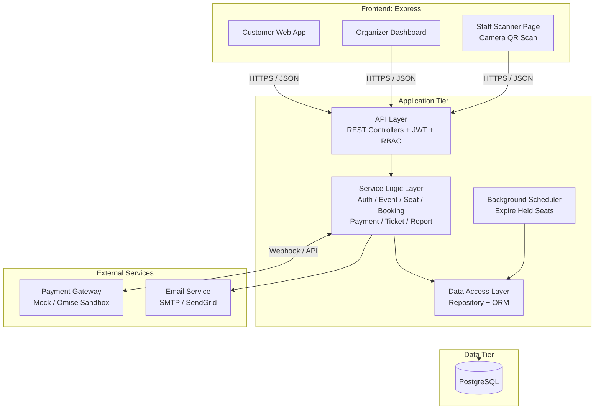
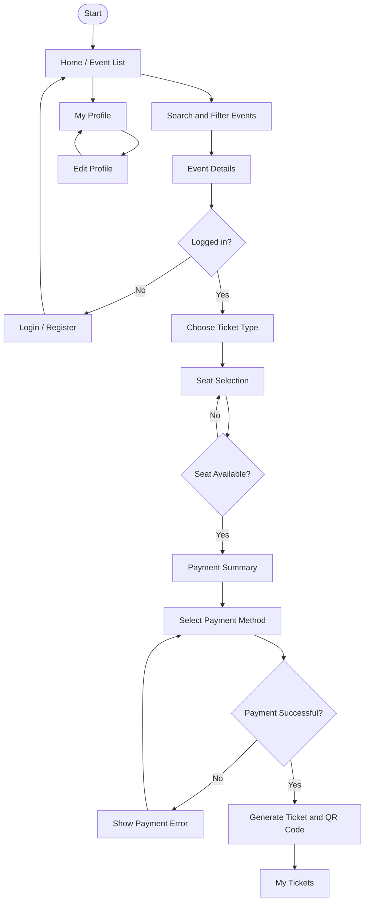

# Phase 2 Report — Initial Design and Prototype
## โครงการ: Ticket Platform Web Application (TicketHub)

> **อ้างอิงรายชื่อสมาชิกกลุ่มและข้อมูลจาก Phase 1:** ดูรายละเอียดสมาชิกกลุ่ม ที่มา วัตถุประสงค์ ขอบเขต ข้อกำหนดเดิม (`FR-01`–`FR-49`, `NFR-01`–`NFR-17`, `UI-01`–`UI-13`), เอกสาร TOR และ Product/Sprint Backlog ได้ที่ [`README.md`](../README.md) และ [`TOR.md`](../TOR.md)

---

## 1. สรุปข้อมูลเดิมจาก Phase 1 (Reference Summary)

* ระบบ **TicketHub** มีเป้าหมายเพื่อแก้ปัญหาการแย่งจองที่นั่งซ้ำซ้อน (Double Booking) และปัญหาบัตรผี/การใช้บัตรซ้ำ โดยมีขอบเขตหลักตั้งแต่ระบบสมาชิก, ค้นหาและกรองกิจกรรม, เลือกผังที่นั่ง, ชำระเงิน, ออกบัตร QR Code และระบบจัดการสำหรับผู้ดูแล
* หลักฐานการเก็บ Requirement (`https://youtu.be/-l-ONZ0Nss0`) และ Retrospective Phase 1 (`https://youtu.be/y5xg2nNoAHg?si=fjigoSF_WZ-VYavK`) บันทึกไว้ใน [`README.md`](../README.md#8-สรุปขั้นตอนการเก็บ-requirement-และการประชุม-retrospective-phase-1)

---

## 2. ความต้องการที่เพิ่มเติมและปรับเปลี่ยนใน Phase 2 (New / Updated Requirements)

จากการทบทวนการออกแบบและรับฟังข้อเสนอแนะหลังจบ Phase 1 ทีมได้เพิ่มข้อกำหนดใหม่และรายละเอียดการตั้งค่าทางเทคนิคดังนี้:

### 2.1 Functional Requirement ที่เพิ่มเติม
| ID | Module | Requirement | Description | เหตุผลที่เพิ่มเติม |
| :--- | :--- | :--- | :--- | :--- |
| **FR-50** | Booking | Ticket Holder Name | ผู้ใช้งานสามารถใส่ชื่อ-สกุลลงในบัตรของแต่ละใบได้ และระบบสามารถตรวจสอบความเป็นเจ้าของบัตรก่อนเข้างาน | ลดปัญหาการนำบัตรไปขายต่อเกินราคา (บัตรผี) และช่วยเจ้าหน้าที่หน้างานยืนยันตัวตนเจ้าของบัตรได้ตรงกัน |

### 2.2 รายละเอียดการตั้งค่าระบบแจ้งเตือนอีเมล (`FR-35` — Email Notification Configuration)
การแจ้งเตือนที่มีช่องทาง `EMAIL` หรือ `BOTH` ออกแบบให้ส่งแบบ Asynchronous ผ่านโปรโตคอล SMTP โดยกำหนดค่าผ่าน Environment Variables และไม่เก็บ Credential จริงไว้ใน Git:

```env
SMTP_HOST=smtp.example.com
SMTP_PORT=587
SMTP_SECURE=false
SMTP_USER=your-smtp-username
SMTP_PASS=your-smtp-password
EMAIL_FROM=TicketHub <tickets@example.com>
```

* สามารถละเว้น `SMTP_USER` และ `SMTP_PASS` ได้กรณีใช้ unauthenticated relay
* ข้อมูลแจ้งเตือนแต่ละรายการเก็บฟิลด์ `emailStatus` (`PENDING`, `SENT`, `FAILED`, หรือ `NOT_CONFIGURED`) เพื่อให้ตรวจสอบความผิดพลาดในการส่งได้

---

## 3. เอกสารการออกแบบระบบ (Design Document)

### 3.1 Architecture Design Diagram (Mermaid)
แผนภาพสถาปัตยกรรมระบบที่ออกแบบใน Phase 2 แสดงการแบ่งชั้น Client, Application Tier (API / Service / Data Access / Scheduler), Data Tier และ External Services:



### 3.2 Use Case & User Journey Flow Diagram (Mermaid)
แผนภาพลำดับการใช้งานหลักของระบบตั้งแต่หน้าแรก ค้นหากิจกรรม ยืนยันตัวตน เลือกที่นั่ง ชำระเงิน จนถึงรับบัตร QR Code และจัดการโปรไฟล์:



### 3.3 การออกแบบ Design System & Initial Prototype Endpoints
* **Typography & Brand Palette:** ใช้ฟอนต์ **Lato** ร่วมกับพาเลตต์ 3 สีหลัก ได้แก่ **Oat Milk (`#FDF9F2`)**, **Monday Blue (`#1D56CF`)**, และ **Candy Apple Red (`#FF0800`)**
* **Seating Plan Visual States:** ที่นั่งว่างแสดงเป็นวงกลมสีดำขอบขาว (`UI-04`), ที่นั่งถูกจอง/ล็อกแล้วแสดงเครื่องหมาย `✕` (`UI-05`), และที่นั่งกำลังเลือกแสดงวงกลมสี Monday Blue พร้อมเครื่องหมาย `✓` (`UI-06`)
* **Initial Prototype Web Pages & User-Input Endpoints (ตามเกณฑ์ Phase 2 >= 2 หน้า + Endpoint ประมวลผล Input):**
  * พัฒนาโครงสร้างหน้าเว็บต้นแบบใน `public/` (เช่น `/home`, `/event`, `/booking`, `/profile`)
  * พัฒนา Express Endpoint รับและประมวลผล Input จากผู้ใช้ เช่น `POST /api/auth/register`, `POST /api/auth/login` และ `GET /api/events?search=...`

---

## 4. ภาพหน้าจอต้นแบบ (Website & Figma Prototype Screenshot)

ภาพต้นแบบหน้าจอที่ออกแบบใน **Figma** แสดงโครงสร้างหน้าแรก, หน้าแสดงรายละเอียดอีเวนต์, หน้าผังที่นั่ง Interactive, หน้าสรุปรายการชำระเงิน และหน้าบัตรอิเล็กทรอนิกส์:


*(ไฟล์ต้นแบบในโปรเจกต์: [`screenshot/design-prototype.png`](../screenshot/design-prototype.png))*

---

## 5. สิ่งที่เปลี่ยนแปลงจากรายงาน Phase 1 และเหตุผลที่เปลี่ยน

| ลำดับ | หัวข้อที่เปลี่ยนแปลง | รายละเอียดใน Phase 1 | สิ่งที่ปรับเปลี่ยนใน Phase 2 | เหตุผลในการเปลี่ยนแปลง |
| :---: | :--- | :--- | :--- | :--- |
| 1 | **ข้อกำหนดการระบุชื่อบนบัตร** | มีข้อกำหนด `FR-01` ถึง `FR-49` ยังไม่ระบุชื่อเจ้าของบัตรรายใบ | เพิ่ม **`FR-50` (Ticket Holder Name)** และปรับเอกสาร [`TOR.md`](../TOR.md) ให้สอดคล้องกัน | เพื่อเพิ่มมาตรการป้องกันบัตรผีและให้เจ้าหน้าที่ตรวจสอบความเป็นเจ้าของบัตรหน้างานได้จริง |
| 2 | **สถาปัตยกรรมระบบแจ้งเตือนอีเมล (`FR-35`)** | ระบุเพียงความต้องการเชิงแนวคิดให้ส่งอีเมลแจ้งเตือนได้ | กำหนดแนวทางเชื่อมต่อผ่าน **SMTP Environment Variables** และติดตามสถานะ `emailStatus` | เพื่อไม่ให้ข้อมูลรหัสผ่าน SMTP หลุดเข้า Git และสามารถตรวจสอบประวัติการส่งอีเมลที่ล้มเหลวได้ |
| 3 | **รายละเอียดหน้าจอและ User Flow** | มีเฉพาะรายการ Requirement เชิงข้อความ | จัดทำต้นแบบ **Figma UI Prototype** และแผนภาพ **Mermaid Architecture + Use Case** | เพื่อให้สมาชิกทั้งฝั่ง Frontend และ Backend เห็นลำดับหน้าจอ โทนสี และโครงสร้าง API ตรงกันก่อนเริ่มพัฒนาเต็มรูปแบบใน Phase 3 |

---

## 6. กระบวนการทำงานที่เพิ่มเติมจาก Phase 1 (Process, Methods, and Tools)

### 6.1 การติดตามสถานะโปรเจกต์และความถี่ของการทำ Scrum
* **Project Status Tracking:** ใช้ **GitHub Issues & Milestones** ร่วมกับบอร์ดติดตามสถานะ (`Open` / `In Progress` / `Closed`) โดยผูก Issue เข้ากับ Milestone ของแต่ละ Sprint และอัปเดตสถานะเมื่อมีการเปิดและ Merge Pull Request
* **Scrum Cadence (ความถี่ในการประชุม):** ทีมจัดประชุมวางแผนงานและอัปเดตความคืบหน้า (Sprint Planning & Sync) สัปดาห์ละ **1–2 ครั้ง** และจัด **Sprint Review / Retrospective** ท้ายเฟสทุกครั้งเพื่อตรวจสอบผลงานและปรับปรุงกระบวนการ

### 6.2 มาตรฐานการตั้งชื่อ Branch และรูปแบบ Commit Message
* **Branch Naming Convention:** แบ่ง Branch ตามหน้าที่ชัดเจนเพื่อให้ทำงานขนานกันได้โดยไม่ชนกันบน `main`:
  * `main` — Branch หลักสำหรับเวอร์ชันที่เสถียรและพร้อมส่งมอบ
  * `dev` — Branch กลางสำหรับรวมงานพัฒนาฟีเจอร์ก่อน Merge เข้า `main`
  * `proto` — Branch สำหรับทดลองสร้างต้นแบบ UI และโครงสร้างเว็บใน Phase 2
  * `test` — Branch สำหรับพัฒนาและรันชุดทดสอบ
  * `docs/<topic>` (เช่น `docs/ticket-ownership-validation`) — Branch สำหรับปรับปรุงเอกสารและข้อกำหนด
* **Commit Message Format:** กำหนดรูปแบบข้อความให้กระชับและระบุประเภทงานชัดเจน เช่น ขึ้นต้นด้วย Prefix หรือคำกริยาบอกการกระทำ (`DOCS: ...`, `TEST: ...`, `Add ...`, `Fix ...`, `Update ...`, `Refactor ...`) เพื่อให้ไล่ประวัติการแก้ไขใน `git log` ได้ง่าย

### 6.3 การสื่อสารและเครื่องมือที่เพิ่มเติมใน Phase 2
* **ช่องทางการสื่อสาร (Communication):** สื่อสารประสานงานรายวันผ่านกลุ่มแชต/Voice Call ของทีม ควบคู่กับการคอมเมนต์รีวิวงานผ่าน **GitHub Pull Requests & Issues** และบันทึกการประชุม Retrospective ลง YouTube
* **เครื่องมือที่เพิ่มเติม:**
  * **Figma:** ออกแบบ UI Wireframe, Prototype และระบบ Design Tokens (`#FDF9F2`, `#1D56CF`, `#FF0800`)
  * **Mermaid (`mermaid.live`):** วาดแผนภาพ Architecture Design และ Use Case Diagram แบบ Diagram-as-Code ฝังลงใน Markdown
  * **Express.js & Node.js:** เริ่มขึ้นโครงสร้าง Prototype Server และ Endpoint รับ Input จากผู้ใช้

---

## 7. สรุปการประชุม Retrospective Phase 2

* **สิ่งที่ทำได้ดี (What Went Well):**
  * ต้นแบบหน้าจอใน Figma มีความชัดเจนและสอดคล้องกับธีมสีที่ผู้ใช้งานต้องการ ช่วยให้เริ่มวางโครงสร้าง HTML/CSS และ Route ต้นแบบได้เร็ว
  * แผนภาพ Architecture Design และ Use Case Diagram ช่วยให้ทีมเห็นความเชื่อมโยงระหว่างการล็อกที่นั่งชั่วคราว การชำระเงิน และการออกบัตร QR Code ตรงกัน
* **ปัญหาและอุปสรรคที่พบ (Challenges):**
  * การออกแบบระบบป้องกันการจองซ้ำและการจัดการฐานข้อมูลต้องคำนึงถึงความเร็วในการทดสอบและความสะดวกในการ Deploy ในเฟสถัดไป
  * มีความต้องการเพิ่มเติมด้านการระบุชื่อผู้ถือบัตร (`FR-50`) จึงต้องปรับแก้ข้อมูลใน TOR และผังการจองให้รองรับ
* **แนวทางปรับปรุงสำหรับ Phase 3 (Action Items):**
  * พัฒนาระบบ Backend ตามโครงสร้าง MVC แยกชั้น `models`, `controllers`, `routes` ให้ชัดเจนเพื่อรองรับการเขียน Unit Test และวัด Statement Coverage >= 80%
  * เตรียมสคริปต์ Static/Dynamic Profiling และชุดทดสอบอัตโนมัติ (Unit, E2E Integration, Adversarial) เพื่อยืนยันความถูกต้องของระบบ

* **Retrospective Phase 2 YouTube Link:** https://youtu.be/W9PHzGiH1ts
