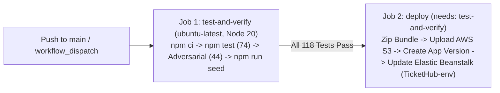

# Phase 4 Report — Final Product, UI Testing, Profiling Comparison & CI/CD
## โครงการ: Ticket Platform Web Application (TicketHub)

> **อ้างอิงรายชื่อสมาชิกกลุ่มและรายงานเฟสก่อนหน้า (References):**
> * **รายชื่อสมาชิกกลุ่ม, Phase 1 (Requirements, TOR, Backlogs):** [`README.md`](../README.md), [`TOR.md`](../TOR.md)
> * **Phase 2 (Initial Design, Figma Prototype, Architecture/Use Case Diagrams):** [`docs/phase-2-report.md`](./phase-2-report.md)
> * **Phase 3 (MVC Implementation, 37 Unit Tests, 97.89% Model Coverage & Profiling Baseline):** [`docs/phase-3-report.md`](./phase-3-report.md)

---

## 1. สถานะความสมบูรณ์ของเว็บไซต์ (Final Website Status & Bug Assessment)

ระบบ **TicketHub** พัฒนาเสร็จสมบูรณ์ครบทั้ง 12 หน้าจอและ 50 HTTP Endpoints รองรับข้อกำหนดทั้งหมด (`FR-01`–`FR-50`, `NFR-01`–`NFR-17`, `UI-01`–`UI-13`) รวมถึงแก้ไขบั๊กการบันทึกข้อมูลอีเวนต์และผังที่นั่ง (`Issue #42`) และปรับปรุง Responsive UI บนหน้าจอมือถือขนาดเล็กสุดถึง `320px` โดยผ่านการทดสอบอัตโนมัติครบทุกชั้นรวม **139 Primary Automated Checks (0 Failures)** (และเมื่อรวมชุดทดสอบเสริม `tests/api.test.js` + `tests/email.service.test.js` ผ่านทั้งหมด **232 / 232 Checks**):
* **Unit Tests (`npm test`):** 26 Data Structure (`tests/unit/models.unit.test.js` เพิ่ม `UT-DS-11b`) + 12 Other Classes (`tests/unit/other-classes.unit.test.js`) = **38 / 38 PASS** (`src/models/*` Statement Coverage เฉลี่ย **97.87%**, ภาพรวม **91.38%**)
* **REST API E2E Integration Tests (`npm test`):** **36 / 36 PASS** (`tests/integration/api-e2e.test.js` เพิ่ม `IT-36` สำหรับ Issue #42)
* **Adversarial Security & Concurrency Harness (`node tests/adversarial-harness.js`):** **44 / 44 PASS** (`failedCount: 0`)
* **Playwright Browser UI Tests (`npm run test:ui`):** **21 / 21 PASS (40.1s)** (Zero JS `pageerror`, Zero HTTP 5xx, Zero horizontal overflow ทั้ง Desktop `1280x800`, Mobile `390x844` และ `320x568`)
* **Extended API & SMTP Service Suites (`tests/api.test.js` & `tests/email.service.test.js`):** **93 / 93 PASS** (90 API E2E + 3 SMTP Email Service)

**ข้อจำกัดที่ขึ้นอยู่กับสภาพแวดล้อมภายนอก (ไม่นับเป็น Bug ของระบบ):**
* การส่งอีเมลจริง (`FR-35`) และ OAuth Login (`Google` / `Facebook`) ต้องกำหนดค่า Credentials (`SMTP_*`, `GOOGLE_CLIENT_ID`, `FACEBOOK_APP_ID`) ในไฟล์ `.env` บนเซิร์ฟเวอร์จริง หากไม่ได้กำหนด ระบบจะจัดการสถานะอย่างปลอดภัย (`NOT_CONFIGURED` / `503`) โดยไม่เกิด Error หรือ Crash

---

## 2. สรุปข้อมูลเดิมจาก Phase 1, Phase 2 และ Phase 3 (Executive Reference)

* **Phase 1 ([`README.md`](../README.md)):** เก็บความต้องการจากผู้ใช้งานจริงนอกกลุ่ม วิเคราะห์ปัญหา Double Booking และบัตรผี จัดทำ `FR-01`–`FR-49`, `NFR-01`–`NFR-17`, `UI-01`–`UI-13`, เอกสาร [`TOR.md`](../TOR.md) และ GitHub Backlogs
* **Phase 2 ([`docs/phase-2-report.md`](./phase-2-report.md)):** เพิ่ม `FR-50` (ระบุชื่อผู้ถือบัตร), ออกแบบ Figma UI Prototype, แผนภาพ Architecture Design & Use Case ด้วย Mermaid และกำหนดมาตรฐาน Scrum / Git Branch / Commit Convention
* **Phase 3 ([`docs/phase-3-report.md`](./phase-3-report.md)):** พัฒนาระบบ MVC สมบูรณ์บน Node.js/Express + `JsonStore`, สร้างชุดทดสอบ Unit/E2E/Adversarial, วัด Statement Coverage ของ `src/models/*` ได้เฉลี่ย **97.89%** (ทุกไฟล์ >= 80%) และเก็บผล Baseline Static & Dynamic Profiling

---

## 3. ภาพหน้าจอของเว็บไซต์ (Website Screenshots)

ระบบเว็บแอปพลิเคชันทั้งหมด 12 หน้าใน `public/` พัฒนาตาม Design System (`Lato`, Oat Milk `#FDF9F2`, Monday Blue `#1D56CF`, Candy Apple Red `#FF0800`) และผ่านการตรวจจับภาพและ Layout บน Desktop (`1280x800`) และ Mobile (`390x844`):

* **ต้นแบบการออกแบบ UI (Figma Prototype):** [`screenshot/design-prototype.png`](../screenshot/design-prototype.png)
  
* **รายการหน้าจอสำคัญของระบบจริง (Live Web Pages บน Local / AWS Elastic Beanstalk):**
  1. **หน้าหลักและค้นหากิจกรรม (`/home` — `public/index.html`):** พื้นหลัง Oat Milk `#FDF9F2`, แถบค้นหา, ตัวกรองจังหวัด/ราคา, การ์ด Popular Event พร้อมปุ่ม CTA สี Candy Apple Red `#FF0800`
  2. **หน้ารายละเอียดกิจกรรม (`/event?id=evt-1` — `public/event.html`):** โปสเตอร์งาน, รายละเอียดรอบแสดง, จำนวนที่นั่งว่างรายโซนแบบ Real-time และปุ่ม `Buy Now`
  3. **หน้าผังที่นั่ง Interactive (`/booking?eventId=evt-1` — `public/booking.html`):** ธีม Monday Blue `#1D56CF`, แท็บเลือกโซน, ผังที่นั่งแยกสถานะว่าง/จองแล้ว (`✕`)/กำลังเลือก (`✓`) พร้อมสรุปราคาและค่าธรรมเนียม
  4. **หน้าชำระเงิน 4 ขั้นตอน (`/checkout` — `public/checkout.html`):** นับถอยหลังล็อกที่นั่ง `10:00`, ช่องใส่โค้ดส่วนลด (`TICKETHUB10`), แลกคะแนนสะสม และจำลองการชำระเงิน 6 ช่องทาง
  5. **หน้าบัตรอิเล็กทรอนิกส์ (`/my-tickets` — `public/my-tickets.html`):** แสดงการ์ดตั๋วพร้อม QR Code PNG Base64, สถานะ `VALID`, และกระดิ่งแจ้งเตือน (`PAYMENT_SUCCESS`)
  6. **หน้าสแกนตรวจบัตร (`/scanner` — `public/scanner.html`):** แสดงผล `ADMISSION GRANTED` เมื่อสแกนครั้งแรก และกล่องแจ้งเตือนสีแดง `DUPLICATE SCAN DETECTED` เมื่อสแกนซ้ำ
  7. **หน้าแผงควบคุมผู้ดูแลระบบ (`/admin` — `public/admin.html`):** แสดง KPI ยอดขาย, กราฟรายเดือน 12 เดือน, แท็บจัดการ Role (ป้องกันลดสิทธิ์ตัวเอง), ตอบกลับ Support และสร้าง/กู้คืน Backup

---

## 4. UI Test Cases จำนวน 5 กรณีทดสอบ (Playwright Automated UI Testing)

ใน Phase 4 ทีมได้เพิ่มชุดทดสอบ **Playwright E2E Browser UI Tests** (`@playwright/test` v1.65.1) รันผ่านคำสั่ง `npm run test:ui` บน Chrome จริงเชื่อมต่อกับ Isolated Test Server (`tests/ui/start-test-server.js`) รวม **21 automated specs (ผ่านครบ 21/21 ใน 40.1 วินาที)**

ด้านล่างคือ **5 UI Test Cases หลัก** ที่มีการตรวจสอบค่า **Expected Results (`expect(...)` assertions)** อย่างชัดเจนครบทุกกรณีทดสอบ:

| รหัส | ชื่อ UI Test Case & ไฟล์อ้างอิง | ขั้นตอนการทดสอบ (Test Steps) | การตรวจสอบค่าที่คาดหวัง (Expected Results & Assertions) | สถานะ |
| :---: | :--- | :--- | :--- | :---: |
| **UI-TC-01** | **Design Tokens, Brand Palette & Event Filter Reset**<br>(`tests/ui/home-auth.spec.js`) | 1. เปิดหน้า `/home`<br>2. อ่านค่า CSS `getComputedStyle` ของ `body`, `.brand-pill`, `#heroBanner .btn-pill-red`<br>3. กรอกคำค้น `'Forza'` ใน `#searchInput`, เลือกจังหวัด `'Nonthaburi'`, เรียงราคา `'price_asc'`<br>4. กดปุ่ม `#resetFilters` | - `fontFamily` ต้องมี `'Lato'`<br>- `bodyBg === 'rgb(253, 249, 242)'` (`#FDF9F2` Oat Milk)<br>- `brandBg === 'rgb(29, 86, 207)'` (`#1D56CF` Monday Blue)<br>- `ctaBg === 'rgb(255, 8, 0)'` (`#FF0800` Candy Apple Red)<br>- `#popularContainer` ต้องมีข้อความ `'Forza Horizon'`<br>- หลังรีเซ็ต: `#searchInput` และ `#provinceFilter` มีค่า `''` และจำนวนการ์ดเท่ากับ `initialCount` | **PASS** |
| **UI-TC-02** | **Auth Modal Validation, Login State & Zero `passwordHash` Leak**<br>(`tests/ui/home-auth.spec.js`) | 1. เปิด Auth Modal และล็อกอินด้วย `user@ticket.com` + รหัสผ่านผิด `'wrong-password'`<br>2. ล็อกอินอีกครั้งด้วยรหัสผ่านที่ถูกต้อง `'password123'`<br>3. ตรวจสอบ DOM, `localStorage` และ `window.Auth.currentUser` | - กรณีรหัสผิด: `#authAlert` ต้องแสดง (`toBeVisible`) และมีข้อความตรง `/invalid/i`<br>- กรณีรหัสถูก: `#authModal` ต้องซ่อน (`toBeHidden`), `.avatar-pill` แสดง `'CH'`<br>- `localStorage.getItem('tickethub_token').length > 10`<br>- `window.Auth.currentUser.email === 'user@ticket.com'`<br>- ไม่พบ `'passwordHash'` ใน `localStorage` และ `window.Auth.currentUser` (`hasPasswordHash === false`) | **PASS** |
| **UI-TC-03** | **End-to-End Seat Selection, 4-Step Checkout, Promo, Payment Retry & QR E-Ticket**<br>(`tests/ui/booking-checkout.spec.js`) | 1. ล็อกอินลูกค้า เข้า `/event?id=evt-1` กด `#buyNowBtn`<br>2. เลือกที่นั่งว่าง 2 ที่นั่ง สลับแท็บโซนแล้วกด `#proceedCheckoutBtn`<br>3. ขั้น 2 ใช้โค้ด `'TICKETHUB10'`<br>4. ขั้น 3 กด `#simulateFailBtn` -> กด `#retryGatewayBtn` -> กด `#confirmPaymentBtn`<br>5. เปิดหน้า `/my-tickets`, เปิดแจ้งเตือน และส่งคำร้องหน้า `/support` | - `#eventTitle` เท่ากับ `'Forza Horizon Somethings Live Festival'` และ URL เปลี่ยนเป็น `/booking?eventId=evt-1`<br>- `.seat.available` และ `.seat.booked` แสดงผล; หลังเลือก 2 ที่นั่ง `.seat.selected` มี count = `2`, `#summarySeatCount` = `'2'`, `#summaryTotal` = `(price1 + price2 + 80).toLocaleString() + ' THB'`<br>- หน้า Checkout: `#countdownTimer` ตรง `/^\d{2}:\d{2}$/`, `#breakdownDiscountRow` แสดงผล<br>- หลังจำลองจ่ายล้มเหลว: `#paymentErrorActions` แสดง; หลังจ่ายสำเร็จ: `#paymentStatusTitle` = `'Payment Successful'`<br>- หน้า My Tickets: `#ticketStatusBadge` = `'VALID'`, `#ticketCode` ตรง `/^TKT-/`, `#ticketQrImage[src]` ตรง `/^data:image\/png;base64,/`<br>- `.notification-badge` แสดงผล และ `#myInquiriesContainer` มี `'Playwright E2E Seat Help'` | **PASS** |
| **UI-TC-04** | **RBAC UI Guards & Staff Gate Scanner Anti-Reuse Fraud Alert**<br>(`tests/ui/rbac-scanner-admin.spec.js`) | 1. ล็อกอินบัญชี `customer` แล้วลองเข้าหน้า `/scanner` และ `/admin`<br>2. ล็อกอินบัญชี `staff@ticket.com` เข้าหน้า `/scanner`<br>3. กรอกรหัสตั๋วใหม่ใน `#manualTicketCode` แล้วกด `#validateCodeBtn` ครั้งที่ 1<br>4. กรอกรหัสตั๋วเดิมแล้วกด `#validateCodeBtn` ซ้ำครั้งที่ 2 | - บัญชี Customer: `#scannerGuard` และ `#admin-guard` ต้องแสดง (`toBeVisible`) ส่วน `#scannerContent` และ `#admin-content` ต้องซ่อน (`toBeHidden`)<br>- บัญชี Staff สแกนครั้งที่ 1: `#scanResultArea` ต้องมีข้อความ `'ADMISSION GRANTED'` และ `'CHECKED_IN'`<br>- บัญชี Staff สแกนซ้ำครั้งที่ 2: `.fraud-warning-alert` ต้องแสดง (`toBeVisible`) และ `#scanResultArea` ต้องมีข้อความ `'DUPLICATE SCAN DETECTED'` | **PASS** |
| **UI-TC-05** | **Admin Portal (Roles, Support, Issue #42 Event Create/Edit) & Multi-Viewport Responsive Integrity**<br>(`tests/ui/rbac-scanner-admin.spec.js`, `tests/ui/responsive-a11y.spec.js`) | 1. ล็อกอิน `admin@ticket.com` เข้า `/admin` ตรวจ KPI, ทดสอบ Anti-Self-Demotion, ตอบกลับ Support<br>2. สร้างอีเวนต์ใหม่ใน `/admin-event.html?mode=create` (2 รอบ, ผัง 3x4, แก้ราคา/สีรายที่นั่ง, ลบ 1 ที่นั่ง) แล้วเปิดหน้า Edit ตรวจข้อมูล<br>3. ทดสอบเปิด 5 เส้นทาง (`/home`, `/event`, `/event?id=evt-1`, `/booking?eventId=evt-1`, `/support`) บน Desktop `1280x800` และ Mobile `390x844` + เมนูแฮมเบอร์เกอร์/Escape, Sticky Summary Bar และความกว้าง `320x568` | - `#kpi-revenue` ไม่เท่ากับ `'0 THB'`, Anti-Self-Demotion แจ้ง `/Cannot demote your own/i` และ dropdown คงค่า `'admin'`, Support เปลี่ยนเป็น `'RESOLVED'`<br>- หน้า Edit อีเวนต์ (Issue #42): ฟิลด์ทั้งหมด (`gallery`, `rounds`, `showTime`, `matrix` 3x4) โหลดตรงค่าเดิม, `#canvas-total-seats` = `'11'`, ที่นั่งแรก `price === 3800` / `color === '#FF0800'`<br>- Responsive ทั้ง 13 specs: `pageErrors === []`, `apiServerErrors === []`, `scrollWidth <= innerWidth + 1` (รวมถึงที่ `320px`), `.nav-toggle-btn` สลับ `aria-expanded` และปิดด้วย `Escape`, `.booking-summary-bar` มี `position: sticky; bottom: 0px` | **PASS** |

### ตัวอย่างโค้ด Playwright UI Test พร้อมการตรวจสอบ Expected Results
จากไฟล์ `tests/ui/rbac-scanner-admin.spec.js`:

```javascript
test('staff validates ticket once on /scanner and sees duplicate scan fraud alert on reuse', async ({ page }) => {
  await page.goto('/home');
  await loginViaModal(page, 'staff@ticket.com', 'staff123');
  await expect(page.locator('#authModal')).toBeHidden();

  await page.goto('/scanner');
  await expect(page.locator('#scannerContent')).toBeVisible();

  // สแกนครั้งที่ 1: ต้องเช็กอินผ่านและขึ้น ADMISSION GRANTED + CHECKED_IN
  await page.locator('#manualTicketCode').fill(freshTicketCode);
  await page.locator('#validateCodeBtn').click();
  await expect(page.locator('#scanResultArea')).toContainText('ADMISSION GRANTED');
  await expect(page.locator('#scanResultArea')).toContainText('CHECKED_IN');

  // สแกนครั้งที่ 2 ด้วยรหัสเดิม: ต้องแสดงกล่องแจ้งเตือนทุจริต FR-31
  await page.locator('#manualTicketCode').fill(freshTicketCode);
  await page.locator('#validateCodeBtn').click();
  await expect(page.locator('#scanResultArea .fraud-warning-alert')).toBeVisible();
  await expect(page.locator('#scanResultArea')).toContainText('DUPLICATE SCAN DETECTED');
});
```

---

## 5. ผลการทำ Profiling (Static Profiling และ Dynamic Profiling) เปรียบเทียบกับ Phase 3

### 5.1 การเปรียบเทียบ Static Profiling (Phase 3 vs. Phase 4)
ใน Phase 4 ทีมได้แก้ไขบั๊ก Issue #42 ใน `src/models/event.model.js` (เพิ่มการซิงค์ `galleryUrls` / `galleryUrl` และการรักษาข้อมูลรอบแสดง/ที่นั่งแบบ Custom) พร้อมเพิ่มสคริปต์ **`npm run test:plato`** (รัน **Plato** AST-based Static Analyzer บน `src/` — `reports/report.json`) ควบคู่กับ **ESLint v9** (`eslint.config.mjs`, `reports/eslint-report.json`) และเปรียบเทียบผลกับค่าฐานใน Phase 3:

| ไฟล์ (File) | Phase 3: Custom Script<br>SLOC / V(G) / Vol / MI | Phase 4: Custom Script<br>SLOC / V(G) / Vol / MI | Phase 4: Plato AST Analyzer (`src/`)<br>Logical SLOC / V(G) / Vol / Est. Bugs / MI | ผลการเปรียบเทียบ & ข้อวิเคราะห์ |
| :--- | :---: | :---: | :---: | :--- |
| `src/models/user.model.js` | 111 / 57 / 8,140.1 / 20.33 | 111 / 57 / 8,140.1 / 20.33 | 93 / 57 / 5,951.4 / 1.984 / **70.81** | `V(G) = 57` คงที่และตรงกันทั้งสองเครื่องมือ; MI อยู่ในเกณฑ์ดี (70.81) |
| `src/models/event.model.js` | 261 / 143 / 18,931.8 / 0.00 | **299 / 144 / 19,561.7 / 0.00** | 202 / 158 / 15,432.7 / 5.144 / **66.95** | เพิ่มขึ้นเล็กน้อย (+38 SLOC, +1 V(G)) จากการแก้บั๊ก Issue #42 (`galleryUrls` sync); ยังเป็นเป้าหมายหลักในการ Refactor |
| `src/models/category.model.js` | 27 / 5 / 1,241.9 / 46.44 | 27 / 5 / 1,241.9 / 46.44 | 20 / 5 / 861.4 / 0.287 / **77.80** | `V(G) = 5` คงที่; โครงสร้างเรียบง่าย ดูแลรักษาง่ายมาก |
| `src/models/seat.model.js` | 198 / 67 / 10,980.7 / 12.60 | 198 / 67 / 10,980.7 / 12.60 | 160 / 58 / 7,263.6 / 2.421 / **66.50** | คงที่จาก Phase 3; Plato แยก AST ได้ `V(G) = 58`, MI = 66.50 |
| `src/models/booking.model.js` | 79 / 10 / 4,232.8 / 31.87 | 79 / 10 / 4,232.8 / 31.87 | 61 / 10 / 3,092.7 / 1.031 / **77.62** | `V(G) = 10` คงที่และตรงกัน 100%; Maintainability สูง |
| `src/models/payment.model.js` | 42 / 3 / 1,524.3 / 41.90 | 42 / 3 / 1,524.3 / 41.90 | 35 / 3 / 1,150.3 / 0.383 / **73.63** | `V(G) = 3` คงที่; ความเสี่ยงบั๊กต่ำมาก (`0.383`) |
| `src/models/ticket.model.js` | 97 / 13 / 4,561.2 / 29.29 | 97 / 13 / 4,561.2 / 29.29 | 74 / 11 / 3,441.0 / 1.147 / **69.61** | คงที่จาก Phase 3; ความซับซ้อนอยู่ในเกณฑ์ดี |
| `src/models/promotion.model.js` | 12 / 4 / 432.4 / 57.46 | 12 / 4 / 432.4 / 57.46 | 8 / 4 / 282.4 / 0.094 / **81.79** | `V(G) = 4` คงที่; ค่า MI สูงที่สุดในกลุ่ม Models |
| `src/models/notification.model.js` | 60 / 15 / 2,724.8 / 35.14 | 60 / 15 / 2,724.8 / 35.14 | 45 / 14 / 2,065.8 / 0.689 / **70.45** | คงที่จาก Phase 3; `V(G)` ใกล้เคียงกันมาก (15 vs 14) |
| `src/models/support.model.js` | 40 / 2 / 1,909.1 / 41.81 | 40 / 2 / 1,909.1 / 41.81 | 33 / 2 / 1,334.5 / 0.445 / **75.83** | `V(G) = 2` คงที่ 100%; ดูแลรักษาง่าย |
| `src/store/jsonStore.js` | 251 / 46 / 13,433.9 / 12.56 | 251 / 46 / 13,433.9 / 12.56 | 173 / 34 / 8,746.5 / 2.916 / **68.63** | คงที่จาก Phase 3; Plato แยก AST `V(G) = 34`, MI = 68.63 |

* **สรุปผล Static Analysis ภาพรวม Backend (`src/`) และทั้งโปรเจกต์ใน Phase 4:**
  * **Plato Backend Summary (`npm run test:plato` — 40 JS files ใน `src/`):** SLOC รวม `5,623` บรรทัด (เฉลี่ย `140` บรรทัด/ไฟล์), ค่าเฉลี่ย **Maintainability Index = `65.60`** (อยู่ในเกณฑ์ปานกลางถึงดี)
  * **ESLint Static Audit (60 JS files):** ตรวจพบคำเตือนกฎ `complexity > 10` จำนวน `90` จุด, `no-unused-vars` `34` จุด, `no-useless-assignment` `4` จุด, `no-empty` `2` จุด และ `no-undef` `251` จุด (ส่วนใหญ่เกิดจากไฟล์ Frontend ใน `public/js/` ที่อ้างอิง Global Helper ข้ามไฟล์ `<script>` เช่น `API`, `Auth`, `showPopup`)

### 5.2 การเปรียบเทียบ Dynamic Profiling (Phase 3 vs. Phase 4 — Structural / Instrumenting Method)
ตารางเปรียบเทียบผลจากการรัน `npm run test:profile` (Workload เดียวกันครบวงจรตั้งแต่ Reset Seed -> จอง/ล็อกที่นั่ง -> ชำระเงิน -> ออก QR -> สแกนเข้างาน -> ยกเลิก/คืนเงิน -> Backup/Restore) ระหว่าง Phase 3 และ Phase 4:

| ลำดับ | Function / Method | Call Count<br>(P3 / P4) | Phase 3 Inclusive / Exclusive (ms) | Phase 4 Inclusive / Exclusive (ms) | ผลต่าง Inclusive (ms) | วิเคราะห์พฤติกรรม (Comparison Analysis) |
| :---: | :--- | :---: | :---: | :---: | :---: | :--- |
| 1 | `JsonStore.resetWithSeed` | 1 / 1 | 90.231 / 74.879 | **78.007 / 66.866** | **-12.224** | เร็วขึ้น ~13.5% (ทำงานครั้งเดียวตอนตั้งต้นสร้าง Bcrypt hash + เขียนไฟล์เริ่มต้น) |
| 2 | `JsonStore.save` | 42 / 42 | 64.998 / 53.139 | **53.523 / 44.225** | **-11.475** | เร็วขึ้น ~17.7% แต่ยังคงเป็น **คอขวด I/O อันดับ 1** เนื่องจากถูกเรียก 42 ครั้ง (`~1.27 ms/call`) |
| 3 | `TicketModel.issueForBooking` | 1 / 1 | 50.634 / 47.704 | **48.810 / 45.852** | **-1.824** | **คอขวดด้าน CPU:** สร้างภาพ PNG QR Code ด้วย `qrcode.toDataURL` สำหรับตั๋ว 2 ใบ (~48.8 ms คงที่) |
| 4 | `JsonStore.restoreBackup` | 1 / 1 | 31.397 / 17.910 | 39.157 / 27.040 | +7.760 | อ่าน Snapshot JSON และเขียนทับ 10 คอลเล็กชันกลับลงดิสก์ (ผันผวนตาม OS disk cache) |
| 5 | `JsonStore.insert` | 8 / 8 | 12.449 / 0.207 | **10.400 / 0.150** | **-2.049** | Exclusive time ต่ำมาก (`0.150 ms`); เวลาเกือบทั้งหมดมาจาก `save()` |
| 6 | `CategoryModel.findAll` | 1 / 1 | 10.255 / 10.242 | **9.378 / 9.373** | **-0.877** | ใช้ `localeCompare` เรียงชื่อหมวดหมู่ครั้งแรก (Cold start ของ Intl collator) |
| 7 | `JsonStore.ensureDirs` | 43 / 43 | 10.913 / 10.913 | **8.629 / 8.629** | **-2.284** | ถูกเรียกซ้ำ 43 ครั้งทุกครั้งที่ `save()` (ตรวจ `fs.existsSync` ซ้ำซ้อน) |
| 8 | `JsonStore.update` | 7 / 7 | 10.772 / 0.227 | **8.391 / 0.198** | **-2.381** | Exclusive time ต่ำกว่า `0.2 ms`; เวลาส่วนใหญ่คือการบันทึกลงดิสก์ |
| 9 | `SeatModel.holdSeats` | 1 / 1 | 3.012 / 0.072 | **1.660 / 0.067** | **-1.352** | **ตรรกะล็อกที่นั่งเร็วมาก:** Exclusive runtime เพียง `0.067 ms` |
| 10 | `BookingModel.createPending` | 1 / 1 | 2.520 / 0.639 | **1.292 / 0.266** | **-1.228** | Exclusive runtime ลดลงเหลือ `0.266 ms` (คงที่ต่ำกว่า 1 ms) |
| 11 | `SeatModel.generateForEvent` | 1 / 1 | 2.023 / 0.132 | **1.962 / 0.137** | **-0.061** | สร้างผังที่นั่งทั้งหมดในหน่วยความจำใช้ Exclusive time เพียง `0.137 ms` |
| 12 | `SeatModel.markBooked` | 1 / 1 | 2.031 / 0.047 | **1.862 / 0.046** | **-0.169** | Exclusive runtime ต่ำกว่า `0.05 ms` |

* **ข้อสรุปจากการเทียบ Dynamic Profiling (Phase 3 vs. Phase 4):**
  * เวลารวมทั้ง Workload ลดลงจาก **225.7 ms** (Phase 3) เหลือ **212.7 ms** (Phase 4, ดีขึ้น **-13.0 ms หรือ ~5.8%**) แม้ว่าจะมีการเพิ่มฟีเจอร์ซิงค์ `galleryUrls` ใน `EventModel` แล้วก็ตาม
  * ตรรกะธุรกิจใน Memory (`SeatModel`, `BookingModel`, `UserModel`) ยังทำงานระดับ **Sub-millisecond (`0.046–0.266 ms` Exclusive)** ในขณะที่คอขวดหลักยังคงเป็น Disk I/O (`JsonStore.save` 42 calls) และการเรนเดอร์ภาพ QR Code (`TicketModel.issueForBooking`) ซึ่งเป็นจุดเป้าหมายสำคัญหากต้องการขยายสเกลในอนาคต

---

## 6. การทำ CI/CD สำหรับ Product (GitHub Actions & AWS Elastic Beanstalk)

ระบบใช้ **GitHub Actions** (`.github/workflows/deploy-eb.yml`) ในการทดสอบและนำส่งโค้ดขึ้นเซิร์ฟเวอร์จริงแบบอัตโนมัติ (Continuous Integration & Continuous Deployment) เมื่อมีการ Push เข้า Branch `main` หรือสั่งรันผ่าน `workflow_dispatch`:



### ขั้นตอนการทำงานของ Pipeline (`.github/workflows/deploy-eb.yml`)
1. **Job 1 — `test-and-verify` (Automated Test & Security Gate):**
   * รันบน `ubuntu-latest` พร้อมติดตั้ง **Node.js 20** และแพ็กเกจด้วย `npm ci`
   * รันชุดทดสอบ **Unit & E2E Integration Tests** (`npm test` จำนวน 74 ข้อ)
   * รันชุดทดสอบ **Adversarial Auth & Concurrency Harness** (`node tests/adversarial-harness.js` จำนวน 44 ข้อ)
   * รีเซ็ตข้อมูลเริ่มต้นให้สะอาดด้วย `npm run seed` — *หากการทดสอบข้อใดข้อหนึ่งล้มเหลว Pipeline จะหยุดทำงานทันทีและไม่ Deploy โค้ดที่มีบั๊กขึ้น Production*
2. **Job 2 — `deploy` (`needs: test-and-verify`, environment: `aws-secret`):**
   * เตรียมข้อมูล Seed เริ่มต้นและกำหนดสิทธิ์ execute ให้สคริปต์ `.platform/hooks/predeploy/01_persistent_storage.sh` เพื่อป้องกันข้อมูล JSON และไฟล์รูปอัปโหลดสูญหายเมื่อ Deploy เวอร์ชันใหม่
   * บีบอัดไฟล์ที่จำเป็น (`server.js`, `package.json`, `package-lock.json`, `public/`, `src/`, `data/*.json`, `.ebextensions/`, `.platform/`) เป็นแพ็กเกจ `tickethub-v-<timestamp>-<sha>.zip` (ตัด `node_modules/`, `tests/`, `.git/`, `data/backups/` ออก)
   * ตั้งค่า AWS Credentials จาก GitHub Secrets (`aws-secret`) อัปโหลดแพ็กเกจขึ้น **Amazon S3** (`aws s3 cp`)
   * สร้าง Application Version ใหม่ (`aws elasticbeanstalk create-application-version`) และสั่งอัปเดตสภาพแวดล้อม **AWS Elastic Beanstalk (`TicketHub-env`)** ด้วยคำสั่ง `aws elasticbeanstalk update-environment` อัตโนมัติ

---

## 7. กระบวนการทำงานที่เพิ่มเติมจาก Phase 1, 2 และ 3 (Process, Methods, and Tools)

เมื่อเทียบกับ Phase 1–3 ที่เน้นการเก็บ Requirement, ออกแบบ UI, พัฒนา MVC และเขียน Backend Unit Tests แล้ว ใน **Phase 4** ทีมได้ยกระดับกระบวนการทำงานเข้าสู่มาตรฐาน **Production-Grade Quality Engineering** ดังนี้:

### 7.1 การบริหารจัดการโปรเจกต์ (Project & Branch Management)
* **Branch Integration Workflow (`dev` / feature branch -> `main`):** แยก Branch พัฒนา (`dev` และ PR branch เช่น PR #56 `copilot/fix-package-deploy-actions-job`) ออกจากการปล่อยเวอร์ชันจริงบน `main` พร้อมตรวจสอบ Pull Request ก่อนทำการ Merge
* **Dependency & Lockfile Governance:** บังคับให้ซิงค์ `package-lock.json` ทุกครั้งที่เพิ่มเครื่องมือใหม่ (เช่น commit `d548a58 Sync Playwright dependency lockfile`) เพื่อป้องกันความล้มเหลวของคำสั่ง `npm ci` บน GitHub Actions Runner

### 7.2 การติดตามและตรวจสอบการ Build (Build & Deployment Monitoring)
* **Automated Release Gate บน GitHub Actions (`.github/workflows/deploy-eb.yml`):** ตรวจสอบสถานะการ Build และผลทดสอบทั้ง 118 ข้อ (Unit/E2E 74 + Adversarial 44) ก่อนอนุญาตให้อัปโหลด Bundle ขึ้น Amazon S3 และอัปเดต **AWS Elastic Beanstalk (`TicketHub-env`)** พร้อมผูก Version Label เข้ากับ `github.sha` ทำให้สามารถติดตามและย้อนกลับ (Rollback) ได้ทุก Commit

### 7.3 การจัดการบั๊กและการประกันคุณภาพ (Bug Management, UI Testing & Static Analysis Tools)
* **Playwright End-to-End UI Automation (`@playwright/test` + `playwright.config.js`):**
  * เพิ่มการทดสอบระดับเบราว์เซอร์จริง (Chromium/Chrome) ครอบคลุม **21 Test Cases** บน Desktop (`1280x800`), Mobile (`390x844`, `320x568`) และ Admin Event Create/Edit (`Issue #42`)
  * ตั้งค่า **`screenshot: 'only-on-failure'`** และ **`trace: 'retain-on-failure'`** ช่วยให้เมื่อเกิด UI Bug ทีมสามารถเปิดดูภาพหน้าจอและ Time-travel Trace ณ วินาทีที่เกิด Error ได้ทันที
  * ใช้ Isolated Test Server (`tests/ui/start-test-server.js`) ที่สร้าง `DATA_DIR` และ `UPLOAD_DIR` ชั่วคราวใน `os.tmpdir()` แล้วลบทิ้งหลังจบการทดสอบ ป้องกันข้อมูลทดสอบปนเปื้อนฐานข้อมูลหลัก
* **ESLint v9 Flat Config (`eslint.config.mjs`):**
  * ติดตั้งกฎ `js.configs.recommended` และ `complexity: ["warn", 10]` แยกสภาพแวดล้อมชัดเจนระหว่าง Node/CommonJS (`src/`, `server.js`, `tests/`) และ Browser Script (`public/js/`) พร้อมส่งออกผลเป็น JSON (`reports/eslint-report.json`) สำหรับติดตามแก้บั๊กและลด Technical Debt
* **Plato Static Analysis Dashboard (`npm run test:plato` -> `reports/index.html`):**
  * ใช้เครื่องมือวิเคราะห์ AST สร้างรายงาน HTML เชิงโต้ตอบแสดงแนวโน้มค่า Maintainability Index, SLOC และ Cyclomatic Complexity รายไฟล์ของ Backend (`src/` ทั้ง 40 ไฟล์) ช่วยชี้เป้าจุดเสี่ยงที่ควร Refactor ได้อย่างเป็นรูปธรรม

---

## 8. สรุปการประชุม Final Retrospective & ลิงก์นำเสนอผลงาน

### 8.1 สรุปการประชุม Final Retrospective
* **สิ่งที่ทำได้ดีตลอดทั้งโครงการ (Key Achievements):**
  * ส่งมอบระบบ TicketHub ครบทั้ง 80 ข้อกำหนด (`FR-01`–`FR-50`, `NFR-01`–`NFR-17`, `UI-01`–`UI-13`) และผ่านชุดทดสอบอัตโนมัติครบทั้ง Backend, Security/Concurrency และ Browser UI (**139 / 139 Primary Checks** และ **93 / 93 Extended Checks**)
  * วางระบบ CI/CD ผ่าน GitHub Actions (`deploy-eb.yml`) ขึ้นเซิร์ฟเวอร์จริงบน AWS Elastic Beanstalk ได้อย่างเสถียรพร้อมสคริปต์รักษา Persistent Storage
* **ปัญหาและบทเรียนที่ได้รับ (Lessons Learned):**
  * การจัดการ Concurrency Lock (`inFlightEmails`, `inFlightNids`, Atomic Seat Hold) และการเก็บไฟล์ถาวรบน Cloud (`.platform/hooks/predeploy/01_persistent_storage.sh`) เป็นหัวใจสำคัญที่ป้องกันข้อมูลเพี้ยนและสูญหายในระบบจริง
  * การทำ Static/Dynamic Profiling ด้วย Plato, ESLint และ Structural Instrumentation ช่วยชี้เป้าคอขวด (`JsonStore.save`, `event.model.js`) ได้แม่นยำกว่าการคาดเดา
* **แนวทางพัฒนาต่อยอดในอนาคต (Future Roadmap):**
  * ย้ายชั้นจัดเก็บข้อมูลจาก `JsonStore` ไปยัง PostgreSQL + Redis TTL Lock และเพิ่ม WebSocket สำหรับอัปเดตผังที่นั่งแบบ Real-Time

* **Final Retrospective YouTube Link:** `[TODO: Insert Final Retrospective YouTube Link]`

### 8.2 ลิงก์วิดีโอนำเสนอและรายการเตรียมส่งงาน (Presentation & Submission)
* **Presentation Video Link:** `[TODO: Insert Presentation Video Link]`
* **Checklist สำหรับการนำเสนอ (Onsite Presentation):**
  1. อธิบายกระบวนการทำงานและผลการเปรียบเทียบ Static/Dynamic Profiling (Phase 3 vs. Phase 4) ด้วยสไลด์
  2. แสดงโครงสร้างโค้ดเว็บไซต์และ Test Code บน Git Repository พร้อมรันทดสอบสด (`npm test`, `node tests/adversarial-harness.js`, `npm run test:ui`, `npm run test:profile`)
  3. แสดงการทำงานของ CI/CD Pipeline (`deploy-eb.yml`) บน GitHub Actions และ AWS Elastic Beanstalk
  4. Demo การทำงานของเว็บไซต์จริงบน AWS (Discovery -> Booking Seat Matrix -> 4-Step Checkout -> E-Ticket QR -> Staff Gate Scanner -> Admin Dashboard)
* **หมายเหตุการจัดเตรียมไฟล์ Zip ส่งงาน:** ไม่รวมโฟลเดอร์ `node_modules/` และโฟลเดอร์ `reports/` ที่สามารถสร้างใหม่ได้ตอนรันโปรแกรม
